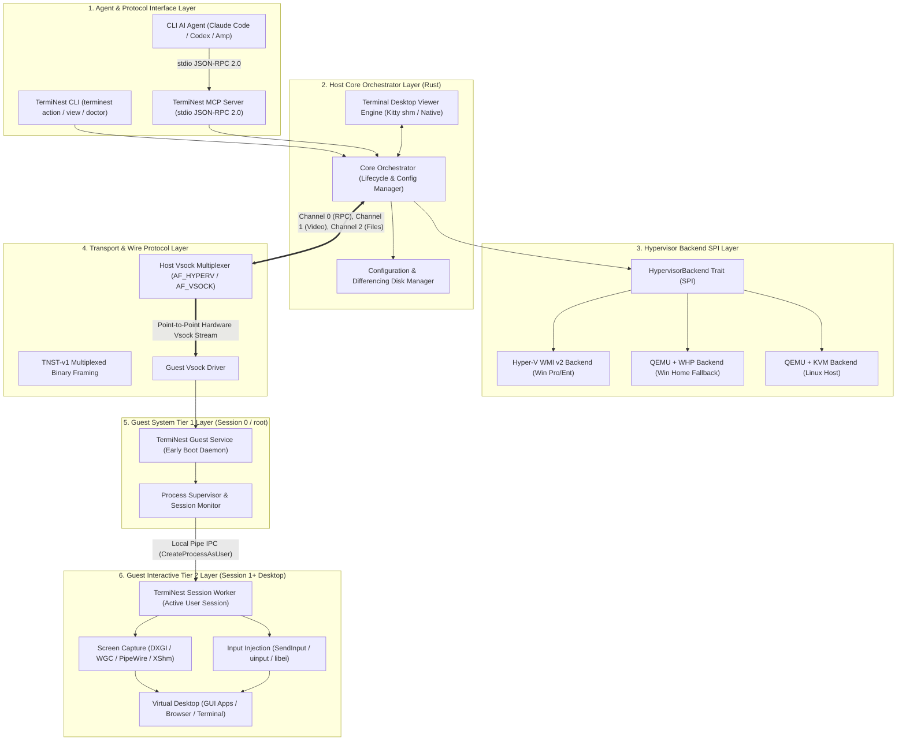

# TermiNest: Master Systems Architecture & Engineering Blueprint

**Project Name:** TermiNest  
**Version:** 1.0.0 (Master Architecture Blueprint)  
**Status:** Approved for Implementation  
**Date:** November 2026  
**Target Systems:** Windows 10/11 (x86_64, aarch64), Linux (x86_64, aarch64)  
**Primary Language:** Rust (Edition 2021/2024)  

---

## 1. Executive Summary & Product Vision

**TermiNest** is a cross-platform virtual computer infrastructure designed to provide autonomous CLI-based AI agents (Claude Code, OpenAI Codex, Cursor, OpenCode, Amp) with dedicated, isolated virtual environments that they can observe and control through standardized computer-use interfaces.

Unlike existing tools that attempt to manipulate the developer's physical desktop, TermiNest guarantees:
1. **Host Desktop Immunity:** The AI agent operates inside an isolated virtual machine; the developer's personal mouse, keyboard, monitor, and clipboard remain untouched.
2. **Defensive Containment:** Malicious code running inside the VM cannot escape to the host filesystem, access host credentials, or probe private local networks.
3. **Cross-Platform Parity:** Engineered for **Windows and Linux hosts**, supporting both **Linux and Windows guests**.
4. **Standardized Agent Interfaces:** Exposes high-performance computer-use tools via the **Model Context Protocol (MCP)**, a native CLI, and real-time terminal desktop viewing (Kitty protocol & native window fallback).

---

## 2. Master System Architecture

TermiNest is organized into six strictly decoupled layers connected by well-defined interfaces and hardware-level isolation boundaries:

---

## 3. Platform Support & Feasibility Matrix

| Host OS | Host Hypervisor | Guest OS | Support Status | Target Horizon | Recommended Use Case |
|---|---|---|---|---|---|
| **Windows 11/10 Pro+** | Hyper-V (WMI v2) | **Ubuntu 24.04 LTS** | **Tier 1 (Canonical MVP)** | Milestone 2 | Primary development & agent evaluation |
| **Linux (Ubuntu/Debian)** | QEMU / KVM | **Ubuntu 24.04 LTS** | **Tier 1 (Canonical)** | Milestone 5 | CI/CD test farms, Linux workstations |
| **Windows 11/10 Home** | QEMU + WHP | **Ubuntu 24.04 LTS** | **Tier 2 (Supported)** | Milestone 2 | Frictionless onboarding for Home users |
| **Windows 11/10 Pro+** | Hyper-V (WMI v2) | **Windows 11 Pro** | **Tier 2 (Supported)** | Milestone 6 | Windows GUI app testing & Office automation |
| **Linux (Ubuntu/Debian)** | QEMU / KVM | **Windows 11 Pro** | **Tier 3 (Specialized)** | Milestone 6 | Cross-platform enterprise validation |

---

## 4. Foundational Architectural Decisions

The architecture incorporates nine binding Architecture Decision Records (ADRs):

1. **Implementation Language ([ADR-0001](adr/0001-core-implementation-language.md)):** **Rust** across all host and guest components. Single native static binaries, zero runtime dependencies, sub-10ms CLI startup, and complete memory safety.
2. **Hypervisor Backends ([ADR-0002](adr/0002-hypervisor-and-virtualization-backends.md)):** Native **Hyper-V WMI v2** on Windows Pro; **QEMU/WHP** on Windows Home; direct **QEMU/KVM** via QMP on Linux.
3. **Transport Protocol ([ADR-0003](adr/0003-host-guest-ipc-and-transport.md)):** Replaced `terminal-mac`'s shared-folder mailbox with **Point-to-Point Vsock (`AF_VSOCK` / `AF_HYPERV`)**. Eliminates disk I/O churn, drops round-trip latency from 25ms to < 0.2ms, and guarantees complete network air-gapping.
4. **Guest Helper Architecture ([ADR-0004](adr/0004-guest-helper-architecture-and-session-model.md)):** **Two-Tier Architecture**. Tier 1 System Daemon (Session 0 / root) handles Vsock connectivity; Tier 2 Session Worker (Session 1+) handles desktop capture and input injection, strictly adhering to OS session isolation.
5. **Screen Capture & Input ([ADR-0005](adr/0005-screen-capture-and-input-injection.md)):** **DXGI Desktop Duplication** & `SendInput` on Windows; **PipeWire / XShm** & `/dev/uinput` on Linux.
6. **Agent Interface ([ADR-0006](adr/0006-mcp-server-architecture.md)):** Single-binary **stdio MCP Server** exposing standardized, idempotent computer-use tools decoupled from hypervisor internals.
7. **Desktop Viewer ([ADR-0007](adr/0007-desktop-viewer-and-terminal-graphics.md)):** Three-tiered viewer: Kitty graphics protocol with shared memory (`t=s`, 30 FPS) for Ghostty/Kitty; chunked base64 fallback; zero-dependency **native mini-window** fallback (`winit`/`softbuffer`, ~5 MB RSS).
8. **Security & Isolation ([ADR-0008](adr/0008-security-boundaries-and-network-isolation.md)):** Three network tiers (`isolated`, `nat`, `bridged`), zero host clipboard bleed, and automatic egress filtering of RFC 1918 and cloud metadata (`169.254.169.254`).
9. **Storage & Ephemeral Execution ([ADR-0009](adr/0009-vm-storage-format-and-state-management.md)):** Sparse dynamic VHDX / QCOW2 with sub-second **Copy-on-Write (CoW) differencing overlays** for instant, disposable test runs.

---

## 5. Complete Blueprint Document Index

### A. Architectural Specifications & Technical Reports
- **[Report 01: Reference Implementation Reverse-Engineering](reports/01-reference-implementation.md):** Deep-dive analysis of `govijr/terminal-mac`, tracing all 9 execution paths, virtio-fs mailbox protocol, and operational realities.
- **[Report 02: Reusable Architectural Principles](reports/02-reusable-design-principles.md):** Architectural patterns extracted from the reference implementation vs. platform-dependent replacements.
- **[Report 03: Platform Feasibility & Compatibility Matrix](reports/03-platform-feasibility.md):** Rigorous analysis of all 4 host/guest OS combinations across Windows and Linux.
- **[Report 04: Product Requirements Specification](reports/04-product-requirements.md):** Comprehensive functional (`REQ-INST`, `REQ-VM`, `REQ-CU`, `REQ-MCP`, `REQ-VIEW`, `REQ-OPS`) and non-functional requirements.
- **[Report 05: Security Architecture & Threat Model](reports/05-security-threat-model.md):** STRIDE threat matrix across 8 trust boundaries, prompt injection defenses, and network isolation tiers.
- **[Report 06: Target System Architecture Specification](reports/06-target-architecture.md):** Complete 6-layer architecture, SPI contracts, two-tier daemon lifecycle, and common computer-use API.
- **[Report 07: Technology Stack & Trade-Off Evaluation](reports/07-technology-evaluation.md):** Language comparison (Rust vs Go vs C++ vs C#), hypervisor evaluation, frame compression benchmarks, and graphics protocols.
- **[Report 08: CLI Specifications & Wire Protocol Design](reports/08-cli-and-protocol-design.md):** Command hierarchy, filesystem layout, `machine.json` schema, and byte-level TNST-v1 binary protocol specs.
- **[Report 09: Testing, Verification, & Quality Strategy](reports/09-testing-and-validation.md):** Test pyramid, `MockHypervisorBackend`, Vsock loopback harnesses, security fuzzing, and latency budgets.
- **[Report 10: Implementation Roadmap & Execution Strategy](reports/10-implementation-roadmap.md):** 8 dependency-ordered milestones (M0 through M7) with relative effort scores and confidence ratings.
- **[Report 11: Technical Risks, Open Questions, & Feasibility Experiments](reports/11-risks-and-open-questions.md):** Failure modes, Windows UAC handling, Wayland portal automation, and 3 bounded feasibility spikes.

### B. Architecture Decision Records (ADRs)
- **[ADR Index & Status](adr/README.md)**
- **[ADR 0001: Core Implementation Language (Rust)](adr/0001-core-implementation-language.md)**
- **[ADR 0002: Hypervisor & Virtualization Backend Selection](adr/0002-hypervisor-and-virtualization-backends.md)**
- **[ADR 0003: Point-to-Point Vsock Transport over Mailbox](adr/0003-host-guest-ipc-and-transport.md)**
- **[ADR 0004: Two-Tier Guest Helper Architecture](adr/0004-guest-helper-architecture-and-session-model.md)**
- **[ADR 0005: Screen Capture & Input Injection Pipelines](adr/0005-screen-capture-and-input-injection.md)**
- **[ADR 0006: MCP Server Stdio JSON-RPC Architecture](adr/0006-mcp-server-architecture.md)**
- **[ADR 0007: Terminal Desktop Viewer & Graphics Protocols](adr/0007-desktop-viewer-and-terminal-graphics.md)**
- **[ADR 0008: Security Boundaries & Network Isolation Tiers](adr/0008-security-boundaries-and-network-isolation.md)**
- **[ADR 0009: VM Storage Formats & Ephemeral State Management](adr/0009-vm-storage-format-and-state-management.md)**

### C. Domain Model, Research, & Skill Inventory
- **[Domain Model & Glossary (GLOSSARY.md)](GLOSSARY.md):** Authoritative ubiquitous language defining 11 core domain concepts.
- **[Primary Research Evidence Ledger (research/sources.md)](research/sources.md):** Verified primary-source citations from Microsoft Learn, Linux Kernel Docs, QEMU QMP, and freedesktop.org.
- **[Research Index (research/README.md)](research/README.md):** Directory structure and research methodology.
- **[Engineering Skill Inventory (skill-inventory.md)](skill-inventory.md):** Audit and catalog of 14 installed engineering skills.

---

## 6. How to Navigate This Blueprint

- **For Systems Engineers & Implementers:** Start with [Report 06 (Target Architecture)](reports/06-target-architecture.md), [Report 08 (CLI & Wire Protocol)](reports/08-cli-and-protocol-design.md), and [Report 10 (Roadmap)](reports/10-implementation-roadmap.md).
- **For Security & Compliance Reviewers:** Review [Report 05 (Security Threat Model)](reports/05-security-threat-model.md) and [ADR 0008 (Security Boundaries)](adr/0008-security-boundaries-and-network-isolation.md).
- **For AI Agent & MCP Integrators:** Review [ADR 0006 (MCP Server Architecture)](adr/0006-mcp-server-architecture.md) and the JSON-RPC schemas in [Report 08](reports/08-cli-and-protocol-design.md).
- **For Virtualization & Kernel Engineers:** Review [Report 03 (Platform Feasibility)](reports/03-platform-feasibility.md), [Report 07 (Technology Evaluation)](reports/07-technology-evaluation.md), and [Report 11 (Risks & Spikes)](reports/11-risks-and-open-questions.md).
