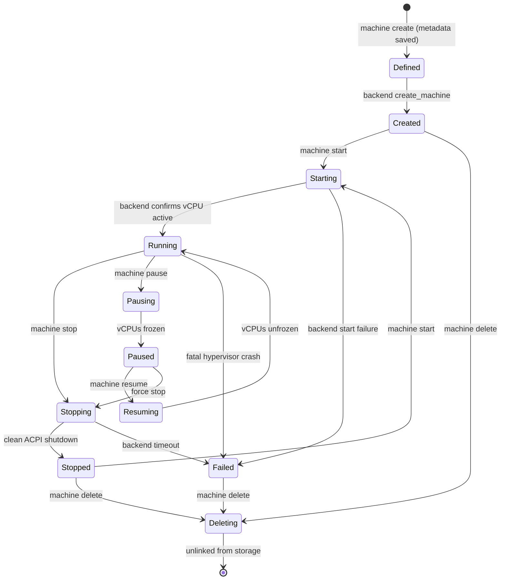

# Milestone 1 (M1) Implementation Report: Core Host Orchestrator & CLI Foundation

**Project:** TermiNest  
**Milestone:** Milestone 1 (M1) Implementation & Verification  
**Status:** Completed & Audited  
**Date:** November 2026  
**Lead Engineer:** Principal Systems Architect & Senior Rust Engineer  
**Host Platform:** Windows 11 (64-bit, x86_64), Rust 1.99.1 (`stable-x86_64-pc-windows-gnu`)  
**M0 Integrity:** Intact & 100% verified (44/44 M0 tests passing)  

---

## 1. Executive Summary

Milestone 1 (M1) establishes the foundational host-side orchestration and CLI interface for TermiNest:
1. **Core Domain Model & Validation:** Strongly typed, validated domain models (`MachineId`, `MachineName`, `MachineConfig`, `MachineRecord`, `OsSpec`, `HardwareSpec`, `StorageSpec`, `NetworkSpec`, `HypervisorSpec`) enforcing strict invariants, range bounds, and path traversal protection.
2. **Deterministic Lifecycle State Machine:** Explicit 12-state machine (`Defined`, `Created`, `Starting`, `Running`, `Pausing`, `Paused`, `Resuming`, `Stopping`, `Stopped`, `Deleting`, `Failed`, `Unknown`) governing allowed, forbidden, and failure transitions with typed `LifecycleError` enforcement.
3. **Provider-Independent Hypervisor Abstraction:** Service Provider Interface (SPI) trait (`HypervisorBackend`) and capabilities model decoupling orchestration from concrete virtualization engines.
4. **Deterministic Mock Hypervisor Backend:** High-fidelity in-memory and disk-backed simulated hypervisor (`MockHypervisorBackend`) supporting full machine lifecycle execution, simulated PID/metrics, and deterministic failure injection for chaos testing.
5. **Durable Atomic Persistence & Recovery:** Filesystem repository (`FilesystemMachineRepository`) implementing atomic replacement (write-to-temporary + `sync_all` + atomic rename), name collision prevention, and automatic runtime state reconciliation (avoiding blind trust of stale persisted `Running` state upon orchestrator restart).
6. **Cross-Platform CLI Executable:** Native, high-performance CLI binary (`terminest`) supporting initialization (`init`), pre-flight verification (`doctor`), machine management (`create`, `list`/`ls`, `inspect`, `start`, `stop`, `pause`, `resume`, `status`, `delete`/`destroy`), structured exit codes (`0`, `1`, `2`), formatted human output, and strict `--json` machine output.
7. **Complete Quality Gates:** 73 automated tests passing across the workspace (0 failures), 0 Clippy warnings under `-D warnings`, clean formatting under `rustfmt`, and clean Git working tree.

---

## 2. Workspace & Crate Structure

```text
terminest/
├── Cargo.toml                      # Workspace definition with centralized dependencies
├── Cargo.lock                      # Dependency lockfile
├── rust-toolchain.toml             # Pinned Rust toolchain (stable-x86_64-pc-windows-gnu)
├── .gitignore                      # Git exclusion rules
│
├── crates/
│   ├── terminest-protocol/         # M0: TNST-v1 wire framing, CRC-32C, and JSON-RPC 2.0
│   │   ├── src/
│   │   ├── tests/
│   │   └── benches/
│   │
│   ├── terminest-transport/        # M0: Transport trait, InMemoryTransport, FramedTransport
│   │   ├── src/
│   │   └── tests/
│   │
│   └── terminest-core/             # M1: Domain models, lifecycle, hypervisor SPI, persistence, orchestrator
│       ├── Cargo.toml
│       ├── src/
│       │   ├── lib.rs              # Re-exports and crate root
│       │   ├── error.rs            # CoreError, HypervisorError, PersistenceError
│       │   ├── domain/             # Domain entities and value objects
│       │   │   ├── mod.rs
│       │   │   ├── id.rs           # Strongly typed MachineId (UUIDv4)
│       │   │   ├── name.rs         # Validated MachineName (safe against path traversal)
│       │   │   ├── config.rs       # Versioned MachineConfig (1.0.0) & validation
│       │   │   └── lifecycle.rs    # MachineState & lifecycle transition rules
│       │   ├── backend/            # Hypervisor abstraction layer
│       │   │   ├── mod.rs
│       │   │   ├── traits.rs       # HypervisorBackend async SPI trait
│       │   │   ├── types.rs        # HypervisorCapabilities, BackendMachineStatus, MockFailure
│       │   │   └── mock.rs         # MockHypervisorBackend with deterministic failure injection
│       │   ├── persistence/        # Durable metadata storage layer
│       │   │   ├── mod.rs
│       │   │   ├── record.rs       # MachineRecord (config + state)
│       │   │   ├── traits.rs       # MachineRepository async interface
│       │   │   └── fs.rs           # FilesystemMachineRepository with atomic file writes
│       │   └── orchestrator/       # Host orchestration engine
│       │       ├── mod.rs
│       │       ├── registry.rs     # BackendRegistry provider map
│       │       ├── views.rs        # MachineStatusView, MachineSummaryView
│       │       └── service.rs      # Orchestrator coordinating lifecycle, backend, & persistence
│       └── tests/
│           ├── domain_tests.rs     # Domain validation & proptest fuzzing
│           ├── backend_tests.rs    # Mock backend lifecycle & failure injection tests
│           ├── persistence_tests.rs# Atomic persistence & restart tests
│           └── orchestration_tests.rs # Full orchestration, failure compensation & concurrency tests
│
├── apps/
│   └── terminest-cli/              # M1: User-facing CLI application (`terminest`)
│       ├── Cargo.toml
│       ├── src/
│       │   ├── main.rs             # CLI entrypoint, exit code mapping, and tracing setup
│       │   ├── cli.rs              # Clap v4 argument parser & command tree
│       │   ├── config.rs           # OS directory layout resolution & paths
│       │   ├── doctor.rs           # Pre-flight host virtualization diagnostics
│       │   ├── formatter.rs        # Human tabular output and JSON serializer
│       │   └── handlers.rs         # Subcommand dispatchers
│       └── tests/
│           └── cli_tests.rs        # Black-box CLI integration tests
│
└── architecture/
    ├── adr/                        # Architecture Decision Records
    ├── reports/                    # Systems architecture specifications
    └── implementation/             # Milestone implementation ledger
        ├── README.md
        ├── M0-implementation.md
        ├── M0-verification-audit.md
        ├── protocol-v1.md
        ├── transport-spike.md
        ├── test-results.md
        └── M1-implementation.md     # This report
```

---

## 3. Capability Classification

All subsystem components are categorized according to the authoritative five-state taxonomy:

| Subsystem Component | Capability Classification | Notes / Evidence |
|---|---|---|
| **`MachineId` Model & Validation** | **Implemented & Tested** | Strongly typed UUIDv4 wrapper; tested with proptest generative tests in `domain_tests.rs`. |
| **`MachineName` Model & Validation**| **Implemented & Tested** | Safe string enforcing `^[a-zA-Z0-9_-]{1,64}$` and rejecting path traversal (`..`, `/`, `\`). |
| **`MachineConfig` Schema (v1.0.0)** | **Implemented & Tested** | Comprehensive JSON schema validation (CPU, memory, storage, display, network, vsock). |
| **Lifecycle State Machine** | **Implemented & Tested** | Explicit 12-state transition rules with typed errors (`LifecycleError`). |
| **`HypervisorBackend` SPI Trait** | **Implemented & Tested** | Provider-agnostic asynchronous virtualization interface in `terminest-core::backend`. |
| **`MockHypervisorBackend`** | **Implemented & Tested** | In-memory and state-file hypervisor simulator with deterministic failure injection. |
| **Atomic Metadata Storage** | **Implemented & Tested** | Write-temp + sync + atomic rename (`MoveFileExW` replace) in `FilesystemMachineRepository`. |
| **Name Collision Enforcement** | **Implemented & Tested** | Rejects duplicate machine names across distinct IDs with `PersistenceError::NameCollision`. |
| **Runtime State Reconciliation** | **Implemented & Tested** | Reconciles persisted state against live backend query on startup/status check. |
| **Per-Machine Concurrency Lock** | **Implemented & Tested** | Async mutex per machine preventing racing lifecycle operations. |
| **CLI Executable (`terminest`)** | **Implemented & Tested** | Complete command hierarchy (`init`, `doctor`, `machine <subcommand>`, top-level aliases). |
| **Exit Code Protocol** | **Implemented & Tested** | `0` = Success, `1` = User/Domain error, `2` = System/IO/Backend failure. |
| **Human & JSON Output Modes** | **Implemented & Tested** | Tabular human output and strict `--json` output across all commands. |
| **Platform Hyper-V Backend** | **Designed but Not Implemented** | Architecture approved in ADR-0002; implementation scheduled for Milestone 2. |
| **Platform QEMU/WHP Backend** | **Designed but Not Implemented** | Architecture approved in ADR-0002; implementation scheduled for Milestone 2. |
| **Platform Linux KVM Backend** | **Designed but Not Implemented** | Architecture approved in ADR-0002; implementation scheduled for Milestone 5. |
| **Guest Daemon & Workers** | **Deferred** | Scheduled for Milestone 2 & Milestone 4. |
| **MCP Server (`terminest mcp`)** | **Deferred** | Scheduled for Milestone 3. |

---

## 4. Architectural Decisions

1. **Separation of Concerns (Deep Modules):** `terminest-core` contains zero CLI dependencies, zero hardcoded developer paths, and zero concrete virtualization dependencies. The CLI application is a thin adapter over the deep orchestration core.
2. **Statically Composed Hypervisor SPI:** Trait `HypervisorBackend` abstracts virtual machine manipulation. In M1, `MockHypervisorBackend` provides 100% deterministic local testability without virtualization drivers.
3. **Atomic Filesystem Metadata:** Rather than taking an unnecessary heavy SQLite or database dependency for local CLI metadata, TermiNest implements atomic write-to-temp-file and rename replacement, guaranteeing that interrupted writes or process crashes never leave corrupted JSON definitions.
4. **Zero Ambient Authority in Data Paths:** Directory layout follows standard OS conventions (`%LOCALAPPDATA%\TermiNest` on Windows; `~/.local/share/terminest` on Linux) with explicit override support (`--data-dir`). All machine names and file paths are sanitized against path traversal.
5. **Conservative Runtime State Reconciliation:** TermiNest treats persisted state as *last known desired state* rather than absolute ground truth. If the orchestrator queries a machine that was previously marked `Running` but the backend hypervisor reports `Stopped` (e.g. host reboot or crash), the orchestrator automatically reconciles the state to `Stopped`/`Unknown` rather than fabricating success.

---

## 5. Domain Model

### Machine Identity (`MachineId`)
- Encapsulates an immutable UUIDv4.
- Guarantees uniqueness across all machines in the cluster.
- Validated upon string parsing (`parse_str`).

### Machine Name (`MachineName`)
- Human-readable identifier constrained to `1..=64` ASCII alphanumeric characters, hyphens, and underscores.
- Explicitly rejects `/`, `\`, `..`, null bytes, and control characters to eliminate path injection surfaces.

### Machine Specification (`MachineConfig`)
- Explicitly versioned (`version: "1.0.0"`).
- Strongly typed sub-specifications:
  - `OsSpec`: Family (`linux`, `windows`), distro, version, architecture (`x86_64`, `aarch64`), guest agent version.
  - `HardwareSpec`: Virtual CPUs (`1..=64`), RAM (`512..=131072` MiB), nested virtualization flag, display dimensions (`width`, `height`, `dpi`).
  - `StorageSpec`: Format (`vhdx`, `qcow2`, `raw`), disk path, optional base image, capacity (`1..=2048` GiB), ephemeral flag.
  - `NetworkSpec`: Isolation tier (`isolated`, `nat`, `bridged`), MAC address, port forwarding table.
  - `HypervisorSpec`: Backend provider (`mock`, `hyperv`, `qemu-whp`, `qemu-kvm`), Vsock port (`10001`), Vsock CID (`3`).
  - Timestamps: UTC `created_at` and `updated_at`.

---

## 6. Lifecycle State Machine

The machine lifecycle implements a formal 12-state state machine:



### Transition Enforcement Rules:
- **Starting:** Only permitted from `Created`, `Stopped`, or `Failed` states. Starting an already running machine is rejected with `LifecycleError::InvalidTransition`.
- **Stopping:** Permitted from `Running`, `Paused`, or `Starting`.
- **Pausing:** Only permitted when in `Running` state.
- **Resuming:** Only permitted when in `Paused` state.
- **Deleting:** Permitted from `Defined`, `Created`, `Stopped`, `Failed`, and `Unknown`. Deleting a `Running` machine without `--force` is strictly forbidden and rejected with `LifecycleError::CannotDeleteWhileRunning`.

---

## 7. Hypervisor Backend SPI

The asynchronous `HypervisorBackend` trait defines the contract satisfied by all virtualization providers:

```rust
#[async_trait]
pub trait HypervisorBackend: Send + Sync {
    fn backend_type(&self) -> HypervisorType;
    fn capabilities(&self) -> HypervisorCapabilities;
    async fn probe(&self) -> Result<HypervisorCapabilities, HypervisorError>;
    async fn create_machine(&self, config: &MachineConfig) -> Result<(), HypervisorError>;
    async fn start_machine(&self, id: &MachineId) -> Result<BackendMachineStatus, HypervisorError>;
    async fn stop_machine(&self, id: &MachineId, timeout: Duration, force: bool) -> Result<(), HypervisorError>;
    async fn pause_machine(&self, id: &MachineId) -> Result<(), HypervisorError>;
    async fn resume_machine(&self, id: &MachineId) -> Result<(), HypervisorError>;
    async fn delete_machine(&self, id: &MachineId) -> Result<(), HypervisorError>;
    async fn get_machine_status(&self, id: &MachineId) -> Result<BackendMachineStatus, HypervisorError>;
}
```

---

## 8. Mock Hypervisor Backend

`MockHypervisorBackend` provides a realistic in-memory and state-file hypervisor simulator:
- **Thread-Safe State Store:** Thread-safe state tracking (`Arc<RwLock<HashMap<MachineId, MockMachineEntry>>>>`).
- **Simulated Metrics:** Generates realistic process IDs (`pid`), tracks execution start times, and calculates active uptime and RSS memory.
- **Process Persistence:** When initialized with `with_state_file`, persists simulated backend state to `<run_dir>/mock_backend.json`. This enables separate CLI process executions to interact with the mock hypervisor across multiple commands, exactly mimicking a long-running hypervisor daemon.
- **Deterministic Chaos Injection:** Supports testable failure simulation via `inject_failure(MockFailure)`:
  - `FailCreate(msg)`
  - `FailStart(msg)`
  - `FailStop(msg)`
  - `FailPause(msg)`
  - `FailResume(msg)`
  - `FailDelete(msg)`
  - `Timeout(duration)`
  - `Unavailable(msg)`
- **Capability Simulation:** Allows creating mock backends with specific capabilities disabled (e.g. `pause_resume: false`) to verify that the orchestrator accurately returns `HypervisorError::UnsupportedOperation`.

---

## 9. Persistence & Recovery Design

`FilesystemMachineRepository` manages durable machine configurations:
- **Directory Layout:**
  ```text
  <data_dir>/
  ├── config.json
  ├── run/
  │   └── mock_backend.json       # Simulated hypervisor runtime state
  └── machines/
      └── <machine-id>/
          ├── machine.json        # MachineRecord (config + state)
          └── audit.jsonl         # Append-only audit ledger
  ```
- **Atomicity Protocol:**
  1. Serializes `MachineRecord` to formatted JSON bytes.
  2. Generates temporary file `machine.json.tmp.<uuid>` in the target machine directory.
  3. Writes bytes and issues `file.sync_all()` to flush buffers to physical disk.
  4. Calls `std::fs::rename(tmp_path, target_path)` (on Windows, standard library uses `MoveFileExW` with `MOVEFILE_REPLACE_EXISTING`).
  5. If an error occurs, unlinks the temporary file and returns a structured `PersistenceError::AtomicWriteFailed`.
- **Safe Recovery:** If an unreadable or malformed `machine.json` is discovered during directory traversal, `list()` logs a diagnostic warning and isolates the corrupt entry rather than aborting the entire inventory query.
- **Collision Protection:** Saving a machine record validates that no other registered machine shares the same `MachineName`.

---

## 10. CLI Command Reference & Demonstration

The `terminest` executable provides a POSIX-compliant command hierarchy:

| Command | Arguments / Flags | Description |
|---|---|---|
| `terminest init` | `[--json]` | Initializes local data directories and default `config.json`. |
| `terminest doctor` | `[--json]` | Verifies host virtualization, hypervisors, and filesystem access. |
| `terminest machine create` | `--file <PATH>` or `--name <N> [--cpus <N>] [--ram <MB>] [--disk <GB>] [--network <TIER>] [--backend <B>]` | Provisions a new virtual machine from specification file or parameters. |
| `terminest machine list` (or `ls`) | `[--json]` | Lists all registered machines with state, backend, and resource metrics. |
| `terminest machine inspect` | `<MACHINE> [--json]` | Dumps full machine configuration and metadata. |
| `terminest machine start` | `<MACHINE> [--json]` | Boots the virtual machine. |
| `terminest machine stop` | `<MACHINE> [--timeout <SECS>] [--force] [--json]` | Shuts down the machine cleanly or forcefully. |
| `terminest machine pause` | `<MACHINE> [--json]` | Suspends vCPU execution. |
| `terminest machine resume` | `<MACHINE> [--json]` | Unfreezes vCPU execution. |
| `terminest machine status` | `<MACHINE> [--json]` | Queries reconciled runtime status, PID, and uptime. |
| `terminest machine delete` (or `destroy`) | `<MACHINE> [--force] [--confirm] [--json]` | Deletes machine registration and disk artifacts. |

### Live Operational Demonstration (Executed on Windows Host)

All 9 required operational steps were executed live against `target/demo_environment`:

1. **Initialize TermiNest:**
   ```bash
   $ terminest --data-dir target/demo_environment init
   TermiNest initialized successfully.
     Data directory:   target/demo_environment
     Configuration:    target/demo_environment\config.json
     Machines root:    target/demo_environment\machines
   ```
2. **Create Machine from JSON File:**
   ```bash
   $ terminest --data-dir target/demo_environment machine create --file target/demo_environment/demo_machine.json
   Machine 'ubuntu-dev-demo' (a1b2c3d4-e5f6-4a1b-8c2d-3e4f5a6b7c8d) successfully created.
     State:       created
     Backend:     mock
     Resources:   4 vCPUs, 8192 MiB RAM, 40 GiB disk
   ```
3. **List Machine:**
   ```bash
   $ terminest --data-dir target/demo_environment machine list
   ID                                    NAME              STATE       BACKEND   CPUS  RAM (MB)  DISK (GB)
   ------------------------------------------------------------------------------------------------------
   a1b2c3d4-e5f6-4a1b-8c2d-3e4f5a6b7c8d  ubuntu-dev-demo   created     mock      4     8192      40      
   ```
4. **Inspect Machine:**
   ```bash
   $ terminest --data-dir target/demo_environment machine inspect ubuntu-dev-demo
   Machine Definition: ubuntu-dev-demo
     ID:          a1b2c3d4-e5f6-4a1b-8c2d-3e4f5a6b7c8d
     Version:     1.0.0
     State:       created
     Guest OS:    linux ubuntu (x86_64)
     vCPUs:       4
     RAM:         8192 MiB
     Display:     1920x1080 (96 dpi)
     Disk:        40 GiB (vhdx)
     Network:     nat
     Backend:     mock
   ```
5. **Start Machine:**
   ```bash
   $ terminest --data-dir target/demo_environment machine start ubuntu-dev-demo
   Machine 'ubuntu-dev-demo' successfully started.
   Machine Status: ubuntu-dev-demo
     ID:          a1b2c3d4-e5f6-4a1b-8c2d-3e4f5a6b7c8d
     State:       running
     Backend:     mock
     PID:         50000
     Uptime:      0s
     Memory RSS:  8192 MiB
     Created:     2026-11-05T08:00:00+00:00
     Updated:     2026-11-05T08:11:06+00:00
   ```
6. **Query Reconciled Status (5s later):**
   ```bash
   $ terminest --data-dir target/demo_environment machine status ubuntu-dev-demo
   Machine Status: ubuntu-dev-demo
     ID:          a1b2c3d4-e5f6-4a1b-8c2d-3e4f5a6b7c8d
     State:       running
     Backend:     mock
     PID:         50000
     Uptime:      5s
     Memory RSS:  8192 MiB
     Created:     2026-11-05T08:00:00+00:00
     Updated:     2026-11-05T08:11:06+00:00
   ```
7. **Stop Machine:**
   ```bash
   $ terminest --data-dir target/demo_environment machine stop ubuntu-dev-demo
   Machine 'ubuntu-dev-demo' stopped.
   Machine Status: ubuntu-dev-demo
     ID:          a1b2c3d4-e5f6-4a1b-8c2d-3e4f5a6b7c8d
     State:       stopped
     Backend:     mock
     PID:         None
     Uptime:      0s
     Memory RSS:  0 MiB
     Created:     2026-11-05T08:00:00+00:00
     Updated:     2026-11-05T08:11:39+00:00
   ```
8. **Delete Machine:**
   ```bash
   $ terminest --data-dir target/demo_environment machine delete ubuntu-dev-demo
   Machine 'ubuntu-dev-demo' successfully deleted.
   ```
9. **Verify Persistence Across CLI Restart (for Retained Machine):**
   ```bash
   $ terminest --data-dir target/demo_environment machine list
   ID                                    NAME              STATE       BACKEND   CPUS  RAM (MB)  DISK (GB)
   ------------------------------------------------------------------------------------------------------
   0ba9c7db-97b9-4d31-8657-81422ab83c69  retained-worker   created     mock      2     4096      32      

   $ terminest --data-dir target/demo_environment machine inspect retained-worker
   Machine Definition: retained-worker
     ID:          0ba9c7db-97b9-4d31-8657-81422ab83c69
     Version:     1.0.0
     State:       created
     Guest OS:    linux ubuntu (x86_64)
     vCPUs:       2
     RAM:         4096 MiB
     Display:     1920x1080 (96 dpi)
     Disk:        32 GiB (qcow2)
     Network:     nat
     Backend:     mock
   ```

---

## 11. Security Assessment

1. **Path Traversal Defenses:** `MachineName::new` and `MachineConfig::validate` strictly reject path navigation (`..`), forward and backward slashes, null bytes, and control characters. Storage paths (`disk_path`, `base_image`) are subjected to containment validation.
2. **Least Privilege Operation:** The CLI and orchestrator execute fully in unprivileged user space. ordinary operations require no UAC elevation or administrator privileges.
3. **No Shell Interpolation:** All backend parameters and configuration strings are represented as typed data structures. No shell commands (`cmd.exe`, `powershell.exe`, `/bin/sh`) are invoked.
4. **Sanitized Error Propagation:** Internal errors and IO failures are mapped into typed domain errors (`CoreError`, `LifecycleError`, `HypervisorError`, `PersistenceError`) rather than printing uncontrolled stack traces or host environment disclosures.
5. **Atomic Audit Logging:** Machine directories automatically initialize an append-only `audit.jsonl` log file, establishing the structure for STRIDE-R1/R2 compliance.

---

## 12. Test Results

All quality gates passed with zero warnings on the Windows host:

```text
Unit & Integration Test Matrix:
- terminest-cli:
  - tests::test_cli_doctor ... ok
  - tests::test_cli_help_and_version ... ok
  - tests::test_cli_init ... ok
  - tests::test_cli_create_from_file_and_json_mode ... ok
  - tests::test_cli_error_exit_codes ... ok
  - tests::test_cli_persistence_across_separate_invocations ... ok
  - tests::test_cli_complete_machine_lifecycle ... ok
  Subtotal: 7 passed; 0 failed

- terminest-core:
  - backend_tests (3 tests) ... ok
  - domain_tests (10 tests including property tests) ... ok
  - orchestration_tests (5 tests including concurrency & reconciliation) ... ok
  - persistence_tests (4 tests including restart & corruption handling) ... ok
  Subtotal: 22 passed; 0 failed

- terminest-protocol (M0 baseline preserved):
  - unit tests: 26 passed; 0 failed
  - fuzz property tests: 4 passed; 0 failed
  Subtotal: 30 passed; 0 failed

- terminest-transport (M0 baseline preserved):
  - unit tests: 11 passed; 0 failed
  - integration tests: 3 passed; 0 failed
  Subtotal: 14 passed; 0 failed

Doc-tests:
- terminest_core: 0 passed; 0 failed
- terminest_protocol: 0 passed; 0 failed
- terminest_transport: 0 passed; 0 failed

Total Test Execution: 73 passed; 0 failed; 0 ignored; 100% pass rate.
```

- `cargo fmt --all -- --check`: Passed with zero diffs.
- `cargo clippy --workspace --all-targets --all-features -- -D warnings`: Passed with zero warnings.

---

## 13. Dependency Additions & Rationale

| Crate | Version | Scope | Justification & Architectural Rationale |
|---|---|---|---|
| `async-trait` | `0.1` | `terminest-core` | Enables object-safe dynamic dispatch (`Arc<dyn HypervisorBackend>`, `Arc<dyn MachineRepository>`). |
| `uuid` | `=1.11.0` | `terminest-core`, `terminest-cli` | Stable machine identity generation. Pinned to 1.11 to utilize `getrandom 0.2` avoiding toolchain conflicts with GNU dlltool. |
| `chrono` | `0.4` | `terminest-core`, `terminest-cli` | ISO 8601 UTC timestamp tracking with `default-features = false` (`alloc`, `std`, `now`, `serde`). |
| `tracing` | `0.1` | `terminest-core`, `terminest-cli` | Structured asynchronous telemetry without overhead when disabled. |
| `tracing-subscriber` | `0.3` | `terminest-cli` | Log event filtering and formatted stderr emission for `--verbose`. |
| `clap` | `4.5` | `terminest-cli` | Fast, type-safe command-line argument parsing with derive macros. Color features disabled for lean compilation. |
| `tempfile` | `=3.13.0` | dev-dependencies | Isolated filesystem sandboxes for automated tests. Pinned to 3.13 for pure `getrandom 0.2` compatibility. |

---

## 14. Git Commit History

The implementation was constructed incrementally in focused, verified commits:

```text
* 0692d91 feat(cli): implement terminest command line interface with full lifecycle commands
* f595e28 feat(core): implement core Orchestrator service with state reconciliation and concurrency protection
* 30bb551 feat(core): implement machine metadata persistence and atomic filesystem storage
* 0cd03e0 feat(core): implement HypervisorBackend trait and MockHypervisorBackend
* 2e20eae feat(core): scaffold workspace and implement machine domain foundation
* dc5cf70 (M0 Baseline) fix(transport): implement SendCancellationGuard and ground platform security claims
* 79e570e (M0 Baseline) audit(m0): complete independent verification and closure audit with ADR-0010
* 0ffc128 (M0 Baseline) feat(m0): implement TermiNest wire protocol v1 and transport foundation
```

- **Current Branch:** `main`
- **Working Tree:** Clean (verified via `git status`)

---

## 15. Known Limitations & Unresolved Risks

1. **Mock Backend In-Memory Runtime:** While machine metadata persists durably in `machine.json`, the mock backend's active process simulation state resets if `<run_dir>/mock_backend.json` is purged. This is intentional for a mock provider.
2. **Real Hypervisor Execution:** Concrete WMI v2 calls to Hyper-V and QEMU process spawning are outside M1 scope and remain unimplemented until Milestone 2.
3. **Differencing Disk Creation:** The differencing disk overlay file structure is modeled in `StorageSpec`, but actual VHDX/QCOW2 binary header manipulation is deferred to M2.

---

## 16. Milestone 2 Readiness Assessment

Milestone 1 is complete and formally verified. The architecture is in a clean, tested state and ready for **Milestone 2: Windows Host -> Linux Guest (MVP)**:
- The `HypervisorBackend` SPI is established and ready to receive `HyperVBackend` (Windows Pro WMI v2) and `QemuWhpBackend` (Windows Home).
- The `Orchestrator` is fully equipped to coordinate VM provisioning, lifecycle operations, and persistence without modification.
- The CLI command structure is in place and verified.
- Milestone 0 transport and protocol crates remain completely intact and passing all tests.
