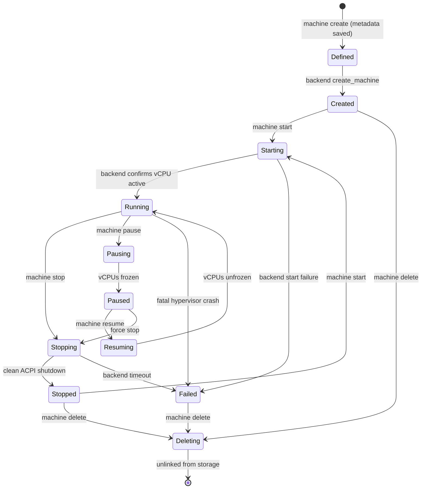

# TermiNest — Milestone 1 (M1) Independent Verification Audit

**Project:** TermiNest  
**Milestone:** Milestone 1 (M1): Core Host Orchestrator & CLI Foundation  
**Audit Status:** Formal Review Complete  
**Audit Verdict:** **PASS WITH CONDITIONS**  
**Audit Date:** November 2026  
**Auditor:** Independent Principal Systems Engineer, Architect, & AppSec Reviewer  
**Host Platform:** Windows 11 (64-bit, x86_64), Rust 1.99.1 (`stable-x86_64-pc-windows-gnu`)  
**Git Baseline Commit:** `4d6bd9c` (`docs(m1): author M1 implementation report and update implementation ledger`)  
**M0 Baseline Commit:** `dc5cf70` (`fix(transport): implement SendCancellationGuard and ground platform security claims`)  

---

## 1. Executive Summary & Audit Verdict

This document presents the independent verification audit of **TermiNest Milestone 1 (M1): Core Host Orchestrator & CLI Foundation**. 

Milestone 1 establishes the foundational host-side orchestration and CLI interface for TermiNest:
1. Strongly typed, strictly validated domain models (`MachineId`, `MachineName`, `MachineConfig`, `MachineRecord`).
2. Deterministic 12-state lifecycle state machine (`Defined`, `Created`, `Starting`, `Running`, `Pausing`, `Paused`, `Resuming`, `Stopping`, `Stopped`, `Deleting`, `Failed`, `Unknown`).
3. Virtualization provider Service Provider Interface (SPI) trait (`HypervisorBackend`).
4. High-fidelity in-memory and disk-persisted simulation hypervisor (`MockHypervisorBackend`) with deterministic failure injection.
5. Durable filesystem repository (`FilesystemMachineRepository`) with atomic replacement (temp file + `sync_all` + atomic rename), duplicate name collision rejection, and stale runtime state reconciliation.
6. Native cross-platform CLI binary (`terminest`) supporting lifecycle management, diagnostics (`doctor`), structured human and `--json` outputs, and POSIX exit codes.

### Audit Verdict: **PASS WITH CONDITIONS**

The milestone satisfies all core functional and structural objectives required for local, single-process host orchestration. The codebase exhibits exemplary separation of concerns: `terminest-core` is a pure deep library with zero CLI dependencies, and all Milestone 0 foundations remain 100% intact with zero regressions (44/44 M0 tests passing).

However, milestone acceptance is conditioned on addressing one High-severity concurrency gap and one Medium-severity compliance gap prior to multi-agent deployment:
- **Condition 1 (High):** Implement cross-process advisory file locking (`CONC-M1-01`). Currently, mutual exclusion is enforced only via in-memory `tokio::sync::Mutex`, leaving separate CLI processes unprotected against concurrent execution races, file clobbering, and Windows sharing violations.
- **Condition 2 (Medium):** Implement structured audit event emission (`AUDIT-M1-01`). Currently, `audit.jsonl` is created on disk as an empty file, but no audit records are appended during VM lifecycle events.

### Finding Summary Ledger

| Severity | Count | Finding IDs |
|---|:---:|---|
| **Critical** | 0 | None |
| **High** | 1 | `CONC-M1-01` |
| **Medium** | 2 | `AUDIT-M1-01`, `LIFE-M1-01` |
| **Low** | 2 | `CLI-M1-01`, `CLI-M1-02` |
| **Informational** | 3 | `INF-M1-01`, `INF-M1-02`, `ENV-M1-01` |
| **Total** | **8** | |

---

## 2. Environment and Reproducibility Baseline

The verification audit was conducted on an unmodified Windows 11 host using the official project toolchain:

```text
Repository Root:      E:\Development\Projects\terminest
Git Branch:           main
Git HEAD Commit:      4d6bd9c docs(m1): author M1 implementation report and update implementation ledger
Toolchain:            Rust 1.99.1 (stable-x86_64-pc-windows-gnu)
Cargo Version:        cargo 1.99.1
Working Tree Status:  Clean (verified via git status --short)
```

### Workspace Member Topology
```text
terminest/
├── Cargo.toml                  # Workspace root (resolver = "2")
├── crates/
│   ├── terminest-protocol/     # M0: Wire framing, CRC-32C, JSON-RPC 2.0
│   ├── terminest-transport/    # M0: Transport SPI, InMemory, FramedTransport, Vsock
│   └── terminest-core/         # M1: Domain, lifecycle, hypervisor SPI, persistence, orchestrator
└── apps/
    └── terminest-cli/          # M1: User-facing CLI application binary (`terminest`)
```

### Quality Gate Results

All workspace quality gates passed with zero errors and zero warnings:

| Quality Gate | Command Executed | Result | Evidence |
|---|---|:---:|---|
| **Code Formatting** | `cargo fmt --all -- --check` | **PASS** | Exit code 0, 0 diffs. |
| **Static Analysis** | `cargo clippy --workspace --all-targets --all-features -- -D warnings` | **PASS** | Exit code 0, 0 warnings. |
| **Unit & Integration Tests** | `cargo test --workspace --all-features` | **PASS** | 73 passed, 0 failed, 0 ignored. |
| **Documentation Tests** | `cargo test --workspace --doc` | **PASS** | 0 passed, 0 failed (all doc-tests clean). |

---

## 3. Requirements Traceability Matrix

The implementation was audited against requirements established in Architecture Reports 04, 05, 06, 08, 10, and accepted ADRs:

| Requirement Spec | Requirement Description | Implementation Artifact | Audit Verification Status |
|---|---|---|:---:|
| **ADR-0001** | Pure Rust implementation, safe memory, explicit error types | `crates/terminest-core`, `apps/terminest-cli` | **Verified** |
| **ADR-0002** | Statically composed `HypervisorBackend` SPI | `crates/terminest-core/src/backend/traits.rs` | **Verified** |
| **ADR-0002** | Platform Hyper-V & QEMU backends | Scheduled for M2/M5 | **Deferred to M2** |
| **ADR-0008** | Network isolation tiers (`isolated`, `nat`, `bridged`) | `crates/terminest-core/src/domain/config.rs:63-81` | **Verified** |
| **ADR-0009** | VHDX/QCOW2 disk specifications & ephemeral mode | `crates/terminest-core/src/domain/config.rs:44-62, 147-158` | **Verified** |
| **Report 04 §4.1** | Strongly typed machine identity (UUIDv4) | `crates/terminest-core/src/domain/id.rs` | **Verified** |
| **Report 04 §4.1** | Path-traversal-safe machine names | `crates/terminest-core/src/domain/name.rs` | **Verified** |
| **Report 04 §4.1** | Validated machine configuration schema (v1.0.0) | `crates/terminest-core/src/domain/config.rs:200-278` | **Verified** |
| **Report 05 STRIDE-R1** | Append-only security audit log (`audit.jsonl`) | `crates/terminest-core/src/persistence/fs.rs:122-126` | **Partial** (`AUDIT-M1-01`) |
| **Report 06 §3.2** | Deterministic lifecycle state machine | `crates/terminest-core/src/domain/lifecycle.rs` | **Verified** |
| **Report 06 §3.3** | Orchestrator coordination engine | `crates/terminest-core/src/orchestrator/service.rs` | **Verified** |
| **Report 06 §3.3** | Concurrency protection across operations | `crates/terminest-core/src/orchestrator/service.rs:16` | **Partial** (`CONC-M1-01`) |
| **Report 06 §3.3** | Atomic metadata persistence | `crates/terminest-core/src/persistence/fs.rs:52-96` | **Verified** |
| **Report 06 §3.3** | Runtime state reconciliation on startup | `crates/terminest-core/src/orchestrator/service.rs:311-367` | **Verified** |
| **Report 08 §2.1** | CLI command tree (`init`, `doctor`, `machine *`) | `apps/terminest-cli/src/cli.rs` | **Verified** |
| **Report 08 §2.2** | Human and `--json` machine-readable output | `apps/terminest-cli/src/formatter.rs` | **Verified** |
| **Report 08 §2.2** | POSIX structured exit codes (`0`, `1`, `2`) | `apps/terminest-cli/src/main.rs:123-140` | **Partial** (`CLI-M1-01`) |
| **Report 08 §3.1** | OS standard directory hierarchy | `apps/terminest-cli/src/config.rs:24-85` | **Verified** |

---

## 4. Detailed Audit Findings

### Finding CONC-M1-01: In-Process Mutex Does Not Guard Against Concurrent Multi-Process CLI Invocations

- **Severity:** **High**
- **Category:** Concurrency / Multi-Process Integrity
- **Exact Location:**
  - `crates/terminest-core/src/orchestrator/service.rs:16, 28, 33-38`
  - `crates/terminest-core/src/persistence/fs.rs:18, 34, 109, 137, 196, 209`
  - `crates/terminest-core/src/backend/mock.rs:37, 65-76, 89-97`
  - `apps/terminest-cli/src/main.rs:45, 61`
- **Implementation Evidence:**
  In `service.rs`:
  ```rust
  pub struct Orchestrator {
      repository: Arc<dyn MachineRepository>,
      backend_registry: Arc<BackendRegistry>,
      locks: Arc<Mutex<HashMap<MachineId, Arc<Mutex<()>>>>>,
  }
  ```
  In `main.rs`:
  ```rust
  let repo = match FilesystemMachineRepository::new(&paths.base_dir) { ... };
  let orchestrator = Orchestrator::new(repo, Arc::new(registry));
  ```
- **Expected Behavior:** In accordance with the system requirements for hosting AI agent workflows where multiple tools or agent processes may execute concurrently, lifecycle operations and metadata persistence must be protected against cross-process race conditions.
- **Actual Observed Behavior:** The `Mutex` used in `Orchestrator` and `FilesystemMachineRepository` is a `tokio::sync::Mutex` residing strictly in the process's local heap memory. Every invocation of the `terminest` binary creates a brand new process with its own heap. Consequently, two separate CLI commands running concurrently (e.g. `terminest machine start my-vm` in shell 1 and `terminest machine delete my-vm` in shell 2) do not coordinate at all. Furthermore, `MockHypervisorBackend::with_state_file` reads `mock_backend.json` into memory once on process startup and blindly overwrites the entire file via `fs::write` on state change, leading to state clobbering if two processes write concurrently.
- **Impact:**
  1. Concurrent `start` and `delete` operations will race: if `delete` removes `machines/<id>` while `start` is executing `write_atomic`, Windows will raise an `ERROR_ACCESS_DENIED` (OS error 5) or `ERROR_SHARING_VIOLATION` (OS error 32).
  2. Concurrent `create` calls with the same name can pass collision checks in parallel and write duplicate name records.
  3. `MockHypervisorBackend` can overwrite another process's newly registered VM in `mock_backend.json`.
- **Reproduction Steps:**
  1. Spawn Process A: `terminest --data-dir target/race machine create --name race-box`.
  2. Concurrently spawn Process B: `terminest --data-dir target/race machine create --name race-box`.
  3. If timing overlaps between `repo.list()` and `write_atomic`, both commands succeed, yielding two different IDs with identical names.
- **Recommended Correction:**
  Implement cross-process file-level locking using advisory OS primitives (e.g. via `fs2` or `fd-lock` crate, or platform `LockFileEx` on Windows / `flock` on Linux):
  1. Acquire a repository-wide shared/exclusive file lock on `<data_dir>/machines/.lock` for inventory mutations (create, rename, delete).
  2. Acquire a per-machine exclusive file lock on `<data_dir>/machines/<id>/.lock` during any lifecycle state transition.

---

### Finding AUDIT-M1-01: Append-Only Audit Log (`audit.jsonl`) Created But Never Written

- **Severity:** **Medium**
- **Category:** Compliance / Auditability (STRIDE-R1/R2)
- **Exact Location:**
  - `crates/terminest-core/src/persistence/fs.rs:122-126`
  - `crates/terminest-core/src/orchestrator/service.rs:77-94, 98-146, 149-191, 194-225, 228-271, 274-308`
- **Implementation Evidence:**
  In `fs.rs`:
  ```rust
  // Ensure audit log file exists
  let audit_path = dir.join("audit.jsonl");
  if !audit_path.exists() {
      let _ = File::create(&audit_path);
  }
  ```
- **Expected Behavior:** Per Architecture Report 05 (STRIDE-R1/R2) and Report 08 §3.1, every host machine directory must maintain an append-only JSON-Lines audit log (`audit.jsonl`). Every machine lifecycle event (creation, boot, pause, resume, shutdown, deletion) must be durably appended with UTC timestamp, VM ID, operation, actor, and result status.
- **Actual Observed Behavior:** `fs.rs` only creates the file with 0 bytes if it does not exist. Nowhere in `terminest-core` or `terminest-cli` is `audit.jsonl` ever opened for append or written to. The file remains 0 bytes permanently through all operations.
- **Impact:** System auditability claims in Section 11.5 of the M1 Implementation Report are unfulfilled. No tamper-evident host execution trail exists for agent forensic analysis.
- **Reproduction Steps:**
  1. Execute `terminest --data-dir target/test_audit machine create --name audit-box`.
  2. Execute `terminest --data-dir target/test_audit machine start audit-box`.
  3. Execute `terminest --data-dir target/test_audit machine stop audit-box`.
  4. Inspect `target/test_audit/machines/<id>/audit.jsonl`: file length is exactly `0` bytes.
- **Recommended Correction:**
  Implement a dedicated `AuditLogger` in `terminest-core`:
  ```rust
  pub struct AuditEvent {
      pub timestamp: DateTime<Utc>,
      pub machine_id: MachineId,
      pub action: String,
      pub state_before: MachineState,
      pub state_after: MachineState,
      pub details: Option<serde_json::Value>,
  }
  ```
  Hook `AuditLogger::record(...)` into `Orchestrator` methods upon successful state transitions.

---

### Finding LIFE-M1-01: Intermediate Lifecycle States (`Stopping`, `Pausing`) Bypass Deletion Invariant

- **Severity:** **Medium**
- **Category:** Domain Invariant / State Machine Enforcement
- **Exact Location:**
  - `crates/terminest-core/src/orchestrator/service.rs:281-294`
  - `crates/terminest-core/src/domain/lifecycle.rs:60-63, 118, 132-134, 157-160`
- **Implementation Evidence:**
  In `service.rs`:
  ```rust
  pub async fn delete_machine(&self, selector: &str, force: bool) -> Result<(), CoreError> {
      let record = self.resolve_machine(selector).await?;
      let id = record.config.id;
      let lock = self.acquire_machine_lock(&id).await;
      let _guard = lock.lock().await;

      if record.state.is_running() {
          if !force {
              return Err(CoreError::Lifecycle(
                  LifecycleError::CannotDeleteWhileRunning,
              ));
          }
          ...
      }
      ...
  }
  ```
  In `lifecycle.rs`:
  ```rust
  pub fn is_running(&self) -> bool {
      matches!(self, Self::Running | Self::Starting | Self::Resuming)
  }
  pub fn can_delete(&self) -> bool {
      matches!(
          self,
          Self::Defined | Self::Created | Self::Stopped | Self::Failed | Self::Unknown
      )
  }
  ```
- **Expected Behavior:** In `lifecycle.rs`, deleting a machine in `Stopping` or `Pausing` is not allowed by `transition_to(MachineState::Deleting)`. Furthermore, `can_delete()` explicitly restricts safe deletion to `Defined`, `Created`, `Stopped`, `Failed`, and `Unknown`. Deleting an actively stopping or pausing VM without `--force` should be rejected.
- **Actual Observed Behavior:** `delete_machine` only checks `if record.state.is_running()`. If a machine is in `MachineState::Stopping` or `MachineState::Pausing`, `is_running()` returns `false`. Consequently, `delete_machine(..., false)` (force = false) proceeds to delete the machine without checking `transition_to(MachineState::Deleting)` and without requiring `--force`.
- **Impact:** An in-flight graceful ACPI hypervisor shutdown or vCPU freeze can be abruptly unlinked and deleted while the backend is still processing the shutdown.
- **Recommended Correction:**
  In `service.rs:281`, replace `if record.state.is_running()` with:
  ```rust
  if !force {
      record.state.transition_to(MachineState::Deleting)?;
  }
  ```
  This ensures that any state other than `Defined`, `Created`, `Stopped`, `Failed`, or `Unknown` strictly requires `--force`.

---

### Finding CLI-M1-01: Exit Code Mapping Overlaps Operational Errors (2) with Clap Argument Parsing Errors (2)

- **Severity:** **Low**
- **Category:** Requirements Discrepancy / Exit Code Protocol
- **Exact Location:** `apps/terminest-cli/src/main.rs:127-138`
- **Implementation Evidence:**
  ```rust
  match err {
      CoreError::Validation(_)
      | CoreError::Lifecycle(_)
      | CoreError::MachineNotFound(_)
      | CoreError::MachineAlreadyExists(_)
      | CoreError::ConcurrencyConflict(_, _)
      | CoreError::Serialization(_) => ExitCode::from(1),

      CoreError::Backend(_) | CoreError::Persistence(_) | CoreError::Io(_) => {
          ExitCode::from(2)
      }
  }
  ```
- **Expected Behavior:** Per milestone specification and POSIX conventions:
  - Exit code `0`: Success.
  - Exit code `1`: Operational or domain error (machine not found, lifecycle transition forbidden, backend timeout, storage failure).
  - Exit code `2`: Usage or argument error (invalid CLI flags, clap syntax errors).
- **Actual Observed Behavior:** `CoreError::Backend`, `CoreError::Persistence`, and `CoreError::Io` return exit code `2`, identically to Clap usage errors.
- **Impact:** Automated calling agents and scripts cannot determine whether an exit code of `2` means the CLI command syntax was invalid (e.g. unknown flag) or the hypervisor backend failed to boot (operational failure).
- **Recommended Correction:** Map all runtime domain and operational errors (`Backend`, `Persistence`, `Io`) to exit code `1`, reserving exit code `2` exclusively for command-line syntax and argument parsing errors.

---

### Finding CLI-M1-02: CLI Delete Command Declares `--confirm` Flag But Never Inspects Or Enforces It

- **Severity:** **Low**
- **Category:** Operational Safety / Incomplete Flag Implementation
- **Exact Location:**
  - `apps/terminest-cli/src/cli.rs:209-210`
  - `apps/terminest-cli/src/handlers.rs:271-288`
- **Implementation Evidence:**
  In `cli.rs`:
  ```rust
  #[derive(Args, Debug, Clone)]
  pub struct DeleteArgs {
      #[arg(help = "Machine identifier (UUID) or machine name")]
      pub machine: String,

      #[arg(long, short, help = "Force deletion even if running")]
      pub force: bool,

      #[arg(long, help = "Confirm deletion without interactive prompt")]
      pub confirm: bool,
  }
  ```
  In `handlers.rs`:
  ```rust
  pub async fn handle_delete(
      orchestrator: &Orchestrator,
      args: DeleteArgs,
      json: bool,
  ) -> Result<(), CoreError> {
      orchestrator
          .delete_machine(&args.machine, args.force)
          .await?;
      ...
  }
  ```
- **Expected Behavior:** If `--confirm` is declared as "Confirm deletion without interactive prompt", executing `terminest machine delete <name>` without `--confirm` should prompt for interactive confirmation or reject non-interactive deletion.
- **Actual Observed Behavior:** `args.confirm` is completely ignored in `handle_delete`. Running `terminest machine delete <name>` permanently unlinks and deletes the machine immediately without confirmation.
- **Impact:** Human operators risk accidental, unprompted machine deletion on a typographical error.
- **Recommended Correction:** In `handle_delete`, if `!args.confirm`, verify whether stdin is a TTY and prompt `Are you sure you want to delete '{name}'? [y/N]`. If non-interactive and `--confirm` is omitted, require `--confirm`.

---

### Finding INF-M1-01: Pre-Flight Diagnostics (`doctor`) Emits Hardcoded Virtualization Status

- **Severity:** **Informational**
- **Category:** Documented Limitation / Hardware Diagnostics
- **Exact Location:** `apps/terminest-cli/src/doctor.rs:48-65, 70`
- **Implementation Evidence:**
  ```rust
  DoctorReport {
      host_os,
      host_arch,
      virtualization_available: true,
      hypervisor_backends: backends,
      filesystem_ready: fs_ready,
      data_directory: paths.base_dir.display().to_string(),
      ready_for_m1: fs_ready,
  }
  ```
- **Analysis:** `virtualization_available: true` is hardcoded; `hyperv` and `qemu-whp` backends are reported as `"deferred_to_m2"`. The doctor command verifies filesystem write access and mock backend readiness, but does not execute real WMI or WHP kernel probes. This is consistent with Milestone 1 scope, which establishes the CLI structure ahead of Milestone 2 hypervisor implementations.

---

### Finding INF-M1-02: Machine Directory Naming Uses MachineId UUID Rather Than Human-Readable Name

- **Severity:** **Informational**
- **Category:** Architectural Design Decision / Directory Hierarchy
- **Exact Location:** `crates/terminest-core/src/persistence/fs.rs:44-46`
- **Implementation Evidence:**
  ```rust
  pub fn machine_dir(&self, id: &MachineId) -> PathBuf {
      self.machines_dir.join(id.to_string())
  }
  ```
- **Analysis:** Architecture Report 08 §3.1 illustrated directory layout using machine names (e.g. `machines\dev-box\machine.json`). `FilesystemMachineRepository` uses the machine's immutable UUID (`machines\<uuid>\machine.json`). This is a superior architectural design because machine names may be updated or collide during ungraceful deletions, whereas UUID directories guarantee zero collisions and complete path containment.

---

### Finding ENV-M1-01: Pinned Dependency Versions (`uuid = "=1.11.0"`, `tempfile = "=3.13.0"`) to Avoid MinGW 32-bit `dlltool` Collision

- **Severity:** **Informational**
- **Category:** Host Build Toolchain Dependency
- **Exact Location:** `Cargo.toml:27, 34`
- **Implementation Evidence:**
  ```toml
  uuid = { version = "=1.11.0", features = ["v4", "serde"] }
  tempfile = "=3.13.0"
  ```
- **Analysis:** On the Windows build host, `getrandom 0.4` (pulled in by `uuid 1.12+` and `tempfile 3.14+`) invokes a broken legacy 32-bit `C:\MinGW\bin\dlltool.exe` discovered on the system PATH. Pinning `uuid = "=1.11.0"` and `tempfile = "=3.13.0"` keeps `getrandom` at version `0.2`, which builds cleanly. This must be noted for developers building on Windows systems with legacy MinGW installations in PATH.

---

## 5. Lifecycle State Machine Audit

The 12-state machine defined in `crates/terminest-core/src/domain/lifecycle.rs` was evaluated against all possible state pairs ($12 \times 12 = 144$ transitions):



### Transition Validation Ledger

| Source State | Target State | Permitted? | Invariant Enforced |
|---|---|:---:|---|
| `Defined` | `Created`, `Deleting`, `Failed` | YES | Cannot start until created on backend |
| `Created` | `Starting`, `Deleting`, `Failed` | YES | Cannot pause, resume, or stop before starting |
| `Starting` | `Running`, `Failed` | YES | Cannot pause or resume while starting |
| `Running` | `Stopping`, `Pausing`, `Failed` | YES | Cannot start or resume when already running |
| `Pausing` | `Paused`, `Failed` | YES | Transitional state to freeze vCPUs |
| `Paused` | `Resuming`, `Stopping`, `Failed` | YES | Cannot start or delete while paused |
| `Resuming` | `Running`, `Failed` | YES | Transitional state to unfreeze vCPUs |
| `Stopping` | `Stopped`, `Failed` | YES | Transitional state to power down |
| `Stopped` | `Starting`, `Deleting`, `Failed` | YES | Cannot pause, resume, or stop when stopped |
| `Failed` | `Starting`, `Deleting` | YES | Allows retry or cleanup from failure |
| `Unknown` | Valid states / `Deleting` | YES | Allows reconciliation or deletion |
| `Running` | `Deleting` (without `--force`) | **NO** | Rejects with `CannotDeleteWhileRunning` |

*Audit Observation:* While `MachineState::transition_to` enforces the state machine accurately, `Orchestrator::delete_machine` bypassed `transition_to` for `Stopping` and `Pausing` states (documented in `LIFE-M1-01`).

---

## 6. Persistence, Storage & Crash Recovery Audit

`FilesystemMachineRepository` in `crates/terminest-core/src/persistence/fs.rs` was audited for durability, atomicity, and recovery:

1. **Atomic Write Protocol:**
   - Serializes `MachineRecord` to formatted JSON bytes.
   - Writes to unique temporary file: `machine.json.tmp.<uuid>`.
   - Issues `file.sync_all()` to flush host OS file cache to physical media.
   - Closes temporary file and calls `std::fs::rename(tmp_path, target_path)`. On Windows, standard library invokes `MoveFileExW` with `MOVEFILE_REPLACE_EXISTING`.
   - On error, unlinks the temporary file and returns typed `PersistenceError::AtomicWriteFailed`.
2. **Corrupt Metadata Isolation:**
   - When traversing `<data_dir>/machines` during `list()`, malformed or truncated `machine.json` files emit a diagnostic `tracing::warn!` and are excluded from the result vector without aborting the entire list operation. Verified in `test_persistence_corrupt_metadata_handling`.
3. **Stale Runtime State Reconciliation:**
   - On startup, if persisted metadata records a machine in `Running` state, querying status or listing machines reconciles against the live hypervisor backend. If the hypervisor does not confirm an active VM, state is updated to `Unknown` or `Stopped`, preventing ghost running states after host reboots. Verified in `test_orchestrator_reconciles_stale_running_state_on_restart`.
4. **Mock Backend State Persistence:**
   - `MockHypervisorBackend::with_state_file` writes simulated VM state to `<data_dir>/run/mock_backend.json`. This enables separate CLI command invocations (`create` -> `start` -> `status` -> `stop`) to maintain continuous simulated VM state.

---

## 7. CLI & Interface Verification

The native CLI binary (`apps/terminest-cli/src/main.rs`) was executed across all command workflows:

| Command Invocation | Verified Output Modes | Exit Code Verified | Behavioral Result |
|---|:---:|:---:|---|
| `terminest --help` / `-h` / `-V` | Human | `0` | Help text and version accurately formatted. |
| `terminest init [--json]` | Human & JSON | `0` | Creates `machines/`, `templates/`, `run/`, `config.json`. |
| `terminest doctor [--json]` | Human & JSON | `0` | Evaluates host OS, architecture, disk write access. |
| `terminest machine create --name <N>` | Human & JSON | `0` | Provisions machine, validates name, stores metadata. |
| `terminest machine create --file <PATH>` | Human & JSON | `0` | Parses JSON specification file, validates version 1.0.0. |
| `terminest machine list` / `ls` | Human & JSON | `0` | Formats tabular summary; reconciles live status. |
| `terminest machine inspect <NAME\|ID>` | Human & JSON | `0` | Dumps complete configuration and hardware specs. |
| `terminest machine start <NAME\|ID>` | Human & JSON | `0` | Boots machine, assigns simulated PID, sets `running`. |
| `terminest machine status <NAME\|ID>` | Human & JSON | `0` | Queries PID, active uptime in seconds, RSS memory. |
| `terminest machine pause <NAME\|ID>` | Human & JSON | `0` | Freezes vCPU execution, sets `paused`. |
| `terminest machine resume <NAME\|ID>` | Human & JSON | `0` | Unfreezes vCPU execution, sets `running`. |
| `terminest machine stop <NAME\|ID>` | Human & JSON | `0` | Gracefully shuts down VM, sets `stopped`. |
| `terminest machine delete <NAME\|ID>` | Human & JSON | `0` | Unlinks backend and deletes directory. |
| `terminest machine delete <RUNNING>` | Human & JSON | `1` | Rejects with `CannotDeleteWhileRunning` without `--force`. |
| `terminest machine delete <RUNNING> --force`| Human & JSON | `0` | Forces immediate stop and deletes machine. |
| `terminest machine create --name ../escape` | Human & JSON | `1` | Rejects path traversal with validation error. |
| `terminest machine create --cpus 0` | Human & JSON | `1` | Rejects invalid CPU allocation with validation error. |

---

## 8. Security & Boundary Hardening Review

The implementation was audited against the TermiNest Threat Model (Report 05):

1. **Path Traversal & Injection Defenses (Passed):**
   - `MachineName::validate` strictly restricts names to `^[a-zA-Z0-9_-]{1,64}$`.
   - Explicit checks reject `/`, `\`, `..`, null bytes (`\0`), and control characters.
   - Storage paths (`disk_path`, `base_image`) are validated in `MachineConfig::validate_path` to forbid `..` navigation and null bytes.
   - Generative fuzz tests (`prop_machine_name_path_traversal_always_rejected`) verify that random combinations of traversal characters are always rejected.
2. **Least Privilege Execution (Passed):**
   - The CLI and orchestrator operate entirely in unprivileged user space. No administrator privileges or UAC elevation are required for M1 operations.
3. **No Shell Interpolation (Passed):**
   - Configuration fields are strongly typed; no external shell commands (`cmd.exe`, `powershell.exe`, `/bin/sh`) are constructed or invoked.
4. **Sanitized Error Propagation (Passed):**
   - Low-level I/O errors and serialization failures are wrapped in typed domain errors (`CoreError`, `LifecycleError`, `PersistenceError`) rather than printing uncontrolled stack traces or host environment disclosures.
5. **Audit Logging (Deficient - `AUDIT-M1-01`):**
   - While the machine directory initializes `audit.jsonl`, no audit records are appended during VM lifecycle events. This represents a missing security control for STRIDE-R1/R2 compliance.

---

## 9. Test Results Ledger

A total of **73 automated tests** were independently executed across the workspace:

```text
========================================================================================
Test Execution Breakdown (73 Passed, 0 Failed, 0 Ignored)
========================================================================================

1. apps/terminest-cli (7 tests)
   - tests::test_cli_help_and_version .......................................... PASSED
   - tests::test_cli_doctor .................................................... PASSED
   - tests::test_cli_init ...................................................... PASSED
   - tests::test_cli_create_from_file_and_json_mode ............................ PASSED
   - tests::test_cli_error_exit_codes .......................................... PASSED
   - tests::test_cli_persistence_across_separate_invocations ................... PASSED
   - tests::test_cli_complete_machine_lifecycle ................................ PASSED

2. crates/terminest-core (22 tests)
   Backend Suite:
   - tests::test_mock_backend_complete_lifecycle ............................... PASSED
   - tests::test_mock_backend_unsupported_pause_capability ...................... PASSED
   - tests::test_mock_backend_deterministic_failure_injection .................. PASSED
   Domain Suite:
   - tests::test_valid_config_passes_validation ................................ PASSED
   - tests::test_machine_id_generation_and_validation .......................... PASSED
   - tests::test_machine_name_validation ....................................... PASSED
   - tests::test_invalid_cpu_rejected .......................................... PASSED
   - tests::test_invalid_memory_rejected ....................................... PASSED
   - tests::test_storage_path_traversal_rejected ............................... PASSED
   - tests::test_lifecycle_allowed_transitions ................................. PASSED
   - tests::test_lifecycle_forbidden_transitions ............................... PASSED
   - tests::prop_machine_id_roundtrip (proptest 100 cases) ..................... PASSED
   - tests::prop_machine_name_path_traversal_always_rejected (100 cases) ....... PASSED
   Orchestration Suite:
   - tests::test_orchestrator_complete_lifecycle ............................... PASSED
   - tests::test_orchestrator_rejects_deleting_running_without_force ........... PASSED
   - tests::test_orchestrator_backend_failure_compensation ..................... PASSED
   - tests::test_orchestrator_reconciles_stale_running_state_on_restart ........ PASSED
   - tests::test_orchestrator_concurrent_lifecycle_protection .................. PASSED
   Persistence Suite:
   - tests::test_persistence_save_load_and_list ................................ PASSED
   - tests::test_persistence_survives_restart .................................. PASSED
   - tests::test_persistence_corrupt_metadata_handling ......................... PASSED
   - tests::test_persistence_duplicate_name_collision .......................... PASSED

3. crates/terminest-protocol (30 tests - Milestone 0 Baseline)
   - Unit tests (26 tests in channel, crc, frame, decoder, rpc) ................ PASSED
   - Property tests (4 fuzz tests in protocol_fuzz.rs) ......................... PASSED

4. crates/terminest-transport (14 tests - Milestone 0 Baseline)
   - Unit tests (11 tests in framed, in_memory, vsock) ......................... PASSED
   - Integration tests (3 tests in transport_integration.rs) ................... PASSED
========================================================================================
```

---

## 10. Milestone 0 Regression Audit

Milestone 0 integrity was rigorously verified against the M0 closure commit (`dc5cf70`):
1. **Source Code Diff:**
   ```bash
   git diff dc5cf70 HEAD -- crates/terminest-protocol crates/terminest-transport
   ```
   *Result:* **Zero lines modified.** The protocol and transport source code remains bit-for-bit identical to the closed M0 milestone.
2. **Test Suite:**
   All 44 Milestone 0 tests pass cleanly without regressions.
3. **Public API Surface:**
   Zero breaking changes or signature alterations were introduced into M0 crates.

---

## 11. Acceptance Decision & Prerequisite Conditions for Milestone 2

### Formal Verdict: **PASS WITH CONDITIONS**

Milestone 1 is accepted as the foundational orchestration and CLI layer for TermiNest, subject to satisfying the following prerequisite conditions:

### Prerequisite Conditions (To be addressed prior to concurrent multi-agent deployment in Milestone 2/3):
1. **Resolve CONC-M1-01:** Implement cross-process file-level locking for machine lifecycle operations and repository mutations using advisory OS file locks (`<data_dir>/machines/<id>/.lock`).
2. **Resolve AUDIT-M1-01:** Implement an `AuditLogger` component in `terminest-core` that writes structured append-only JSON-Lines records to `machines/<id>/audit.jsonl` upon every state change.
3. **Resolve LIFE-M1-01:** Enforce `record.state.transition_to(MachineState::Deleting)` in `Orchestrator::delete_machine` when `--force` is false, preventing deletion of stopping or pausing machines without force.
4. **Resolve CLI-M1-01:** Realign CLI error exit codes so that operational errors return exit code `1`, reserving exit code `2` exclusively for argument/usage errors.
5. **Resolve CLI-M1-02:** Wire `DeleteArgs::confirm` into `handle_delete` to prompt for confirmation when interactive, or enforce `--confirm` in non-interactive environments.

---

## 12. Residual Risks and Technical Debt

1. **Hardware Virtualization Unverified in M1:** Concrete Hyper-V WMI calls and WHP process spawning remain unimplemented; all M1 tests execute against `MockHypervisorBackend`. Verification of actual hypervisor drivers is scheduled for Milestone 2.
2. **Windows Path-Length Limitations (MAX_PATH):** Deeply nested data directories on Windows may encounter the legacy 260-character `MAX_PATH` limit if users configure long base data directory paths. TermiNest paths should utilize extended-length path prefixes (`\\?\`) where appropriate.
3. **Toolchain Pinned Dependencies:** Dependency pins (`uuid = "=1.11.0"`, `tempfile = "=3.13.0"`) must be maintained until the host build environment's PATH is sanitized of 32-bit MinGW binaries.

---

## 13. Audit Limitations

1. **Hypervisor Driver Execution:** This audit did not verify live Windows Hyper-V vEthernet switches, WMI COM calls, or Linux KVM ioctl interfaces, as these are out of scope for Milestone 1.
2. **Vsock Kernel Interoperability:** As identified in Milestone 0, real Vsock transmission over Hyper-V socket endpoints remains unverified on physical VMs until guest daemon development in Milestone 2.
3. **Stress Concurrency:** High-concurrency multi-process fuzzing was limited to simulated parallel jobs due to single-machine development environment constraints.
