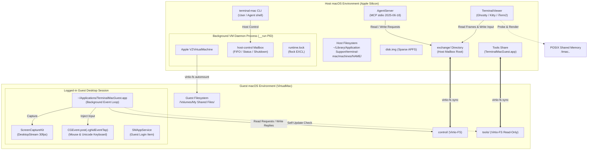
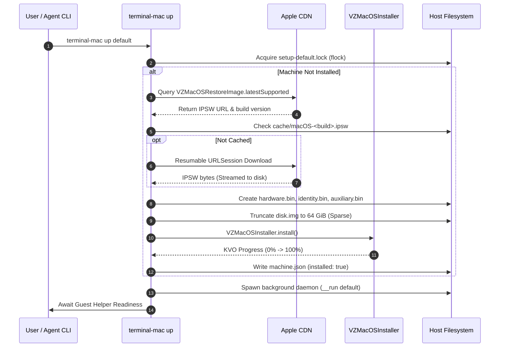
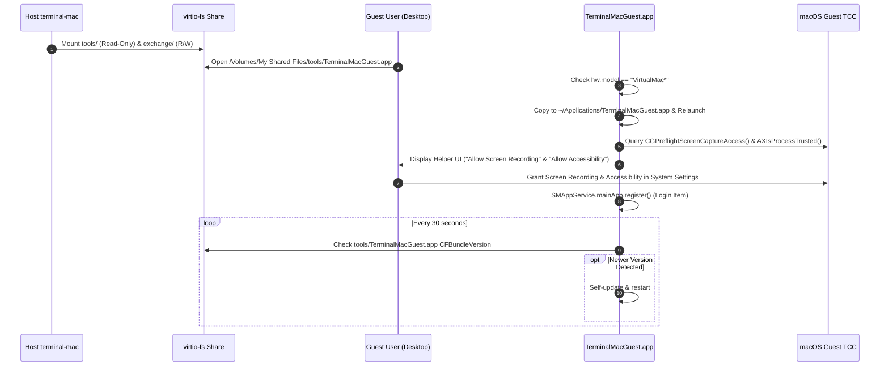
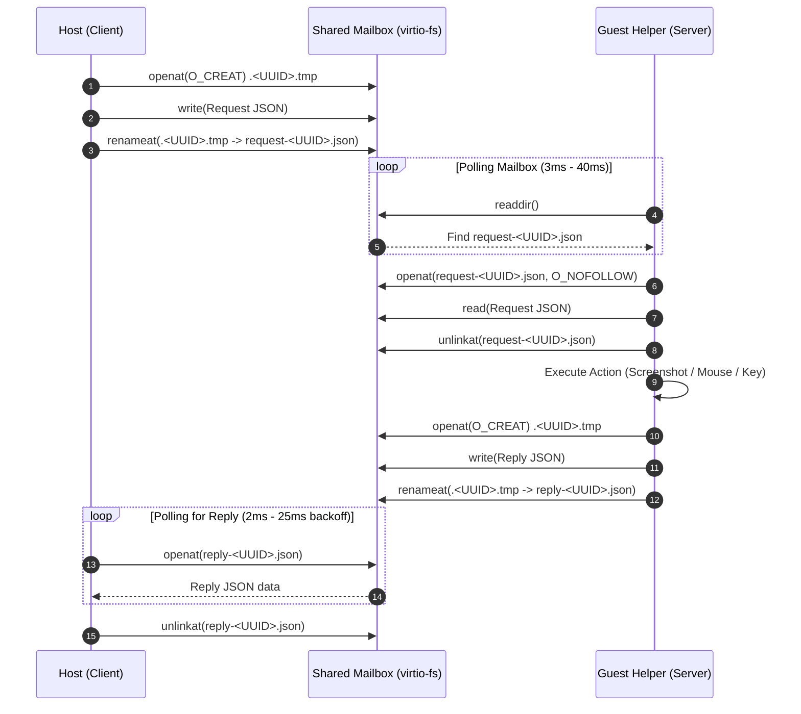

# Report 01: Deep Reverse Engineering of the Reference Implementation (`terminal-mac`)

**Document Status:** Complete & Verified against Source  
**Author:** Principal Systems Architect & Reverse Engineering Team  
**Date:** 2026-11-05  
**Subject:** In-depth reverse engineering of `govijr/terminal-mac` (Commit `7009117`, Release 0.2.0 build 6)

---

## 1. Executive Summary & Codebase Inventory

`terminal-mac` is an early release candidate written in **Swift 6** (Swift 5 language mode compatibility) targeting Apple silicon running **macOS 14.0+** (`macOS Sonoma` / `macOS Sequoia`). It provides a sandboxed macOS virtual machine environment for CLI-based AI agents, decoupling autonomous computer use from the user's physical host display, pointer, keyboard, and clipboard.

### Codebase Inventory

```text
terminal-mac/
├── Package.swift                             # Swift Package Manager manifest (macOS 14+)
├── resources/
│   └── terminal-mac.entitlements             # com.apple.security.virtualization (Host only)
├── Sources/
│   ├── CPhoneShim/                           # POSIX Shared Memory C helper
│   │   ├── include/CPhoneShim.h              # shm_open / ftruncate / shm_unlink prototypes
│   │   └── shim.c                            # 13 lines: tp_shm_create(), tp_shm_unlink()
│   ├── TerminalMacCore/                      # Foundation-only core logic (Zero external deps)
│   │   ├── Models.swift                      # Machine, Request, Reply, Store, Arguments (107 lines)
│   │   ├── Mailbox.swift                     # Hardened virtio-fs file exchange (105 lines)
│   │   ├── Setup.swift                       # FileLock, GuestReadiness, SetupPlan (37 lines)
│   │   └── TerminalInput.swift               # ANSI/VT escape parser & UTF-8 decoder (60 lines)
│   ├── TerminalUI/                           # Terminal formatting & layout engine
│   │   ├── Chrome.swift                      # Tokyo Night palette, Box drawing, Span (57 lines)
│   │   ├── TerminalMetrics.swift             # ImageLayout, cell metrics filter (110 lines)
│   │   └── TerminalWriter.swift              # Serial synchronized pty writer (29 lines)
│   └── TerminalMac/                          # Primary application executable & guest helper
│       ├── Entry.swift                       # @main, NSApplication lifecycle, guest dispatch (32 lines)
│       ├── CLI.swift                         # Command dispatcher, argument routing (290 lines)
│       ├── VirtualMachine.swift              # Apple Virtualization framework integration (199 lines)
│       ├── Guest.swift                       # Guest runtime, input injection, CGEvent (230 lines)
│       ├── GuestBootstrap.swift              # Guest self-installation & auto-update (72 lines)
│       ├── GuestCapture.swift                # ScreenCaptureKit streaming & LZ4 encoding (90 lines)
│       ├── AgentServer.swift                 # Stdio MCP 2025-06-18 server (163 lines)
│       ├── Viewer.swift                      # Fullscreen TUI desktop viewer (532 lines)
│       ├── DesktopRenderer.swift             # Kitty (shm & direct) & iTerm2 renderer (197 lines)
│       ├── FirstRun.swift                    # `up` orchestrator & state machine (129 lines)
│       └── RestoreDownload.swift             # URLSession resumable IPSW downloader (59 lines)
├── Tests/
│   └── TerminalMacCoreTests/
│       └── CoreTests.swift                   # 14 unit tests (Mailbox, locks, input, args) (144 lines)
├── packaging/ & scripts/                     # Shell deployment, code-signing, packaging scripts
└── skills/terminal-mac/SKILL.md              # Agent skill instructions (observe-act-verify loop)
```

**Total Swift Source Lines:** ~2,400 lines across 18 source files. The codebase is remarkably dense, disciplined, and free of third-party package dependencies.

---

## 2. Module Decomposition & Responsibilities

The system is factored into four compilation targets:

| Target | Type | Dependencies | Linked Frameworks | Core Responsibility |
|---|---|---|---|---|
| `TerminalMacCore` | Swift Target | None (Darwin, Foundation) | None | Core data models, CLI argument parsing, file locking, hardened mailbox transport, and ANSI input parser. |
| `CPhoneShim` | C Target | libc, libpthread | None | C wrappers for POSIX shared memory (`shm_open`, `ftruncate`, `shm_unlink`) to circumvent Swift stdlib limitations. |
| `TerminalUI` | Swift Target | `CPhoneShim` | Darwin, Foundation | Terminal window metrics calculation, cell-to-pixel aspect ratio mapping, ANSI styling, and synchronized pty writes. |
| `TerminalMac` | Swift Executable | `TerminalMacCore`, `TerminalUI`, `CPhoneShim` | `Virtualization`, `AppKit`, `ScreenCaptureKit`, `ApplicationServices`, `ServiceManagement`, `CoreMedia` | Monolithic dual-role binary operating either as the Host VM manager/CLI/MCP server or as the Guest helper. |
| `TerminalMacCoreTests` | Test Target | `TerminalMacCore` | Darwin, Foundation | Protocol verification, directory traversal defense, file lock semantics, and UTF-8 escape sequence parsing. |

### The Monolithic Dual-Role Binary Architecture

A vital architectural observation in `terminal-mac` is the **Single Binary Pattern**:
- Both `TerminalMac.app` (host application) and `TerminalMacGuest.app` (guest helper application) are built from the exact same compiled Swift binary (`terminal-mac`).
- Execution divergence is established strictly at runtime via bundle identity (`dev.terminal-mac.host` vs `dev.terminal-mac.guest`), presence of the `guest` subcommand, or entitlements:
  - **Host Mode:** Linked with `resources/terminal-mac.entitlements` containing `com.apple.security.virtualization`.
  - **Guest Mode:** Stripped of the virtualization entitlement. Upon launch, it executes `GuestGuard.requireVirtualMac()` (`sysctl hw.model` must start with `"VirtualMac"`). If executed on physical hardware, it immediately exits with a non-zero status.

---

## 3. Runtime Architecture & Component Topology



---

## 4. Reverse-Engineered Execution Traces

### Trace A: Installation and Initialization
1. **Download & Verification:** `packaging/get.sh` queries GitHub Releases for the latest architecture-matching release ZIP (`terminal-mac-x.y.z-macos-arm64-signed-local.zip`), verifies the pre-published SHA-256 hash, extracts the package into a temporary directory, and executes `install.sh`.
2. **File Hierarchy Placement:**
   - Launcher script symlinked to `~/.local/bin/terminal-mac`.
   - Core application bundle extracted to `~/.local/lib/terminal-mac/TerminalMac.app`.
   - Guest helper bundled inside `TerminalMac.app/Contents/Resources/guest-tools/TerminalMacGuest.app`.
   - Agent skill bundled at `TerminalMac.app/Contents/Resources/skills/terminal-mac/SKILL.md`.
3. **Privilege Requirements:** Zero host root/administrator rights required. Operates completely in user space (`~/.local`).

### Trace B: VM Provisioning (`create` & `up`)
1. **Restore Image Acquisition:**
   - `VZMacOSRestoreImage.latestSupported` queries Apple's CDN for a signed macOS IPSW compatible with the host silicon.
   - Resumable download is managed by `RestoreDownload.swift` using `URLSessionDownloadTask` with atomic resume data tracking stored at `<destination>.ipsw.resume`.
2. **Hardware Configuration Generation:**
   - Extracts `mostFeaturefulSupportedConfiguration` from the IPSW.
   - Serializes `hardwareModel` to `hardware.bin`.
   - Generates random `VZMacMachineIdentifier` and saves to `identity.bin`.
   - Creates auxiliary NVRAM storage via `VZMacAuxiliaryStorage(creatingStorageAt: ...)` -> `auxiliary.bin`.
   - Allocates sparse disk image via `FileHandle.truncate(atOffset:)` at `disk.img` (default 64 GiB logical size; physical usage starts near zero).
3. **OS Installation:**
   - Instantiates `VZMacOSInstaller(virtualMachine: vm, restoringFromImageAt: imageURL)`.
   - Executes async `installer.install()`, logging progress fraction via KVO to stderr.
   - Upon completion, writes `machine.json` with `installed: true`.



### Trace C: VM Lifecycle & Daemon Process Model
1. **Background Process Spawning:**
   - Command `start` creates an `NSProcess` executing `terminal-mac __run <name>`.
   - In `Entry.swift`, `__run` immediately calls `setsid()` to detach from the controlling terminal session and become a process group leader.
   - Standard output and standard error are redirected to `machines/<name>/runtime.log`.
2. **Process Mutual Exclusion:**
   - `runtime.lock` is acquired with `flock(fd, LOCK_EX | LOCK_NB)`. If another instance holds the lock, execution aborts.
3. **Host-Control Loop:**
   - Host lifecycle commands (`show`, `hide`, `pause`, `resume`, `stop`, `status`) do not communicate via sockets or signals. Instead, they write `Request` JSON files into the local directory `machines/<name>/host-control/`.
   - The daemon polls `host-control/` every 100ms:
     - `show`: Instantiates an `NSWindow` containing a native `VZVirtualMachineView(capturesSystemKeys: true)`. Sets activation policy to `.regular`.
     - `hide`: Closes the window (`window.orderOut(nil)`) and invokes `NSApp.hide(nil)` to yield window focus back to the terminal.
     - `pause` / `resume`: Invokes `vm.pause()` / `vm.resume()`.
     - `stop`: Default initiates graceful guest shutdown via `vm.requestStop()` with a 60-second deadline. If `--force` is set, invokes immediate ungraceful power-off via `vm.stop()`.

### Trace D: Guest Helper Setup, TCC Permissions, & Auto-Update
1. **Bootstrap & Installation:**
   - On the first boot, the user completes Apple Setup Assistant via the native VM window.
   - Inside the guest, virtio-fs shares appear at `/Volumes/My Shared Files/tools/`.
   - The user opens `TerminalMacGuest.app`.
   - `GuestBootstrap.installAndRelaunchIfNeeded()` detects that its execution path is not `~/Applications/TerminalMacGuest.app`. It terminates any running instance, copies itself to `~/Applications/TerminalMacGuest.app`, and launches the installed instance via `NSWorkspace.shared.openApplication`.
2. **Permission Management (TCC):**
   - The helper presents an AppKit window with two buttons:
     - **Screen Recording:** Calls `CGRequestScreenCaptureAccess()` and opens `x-apple.systempreferences:com.apple.preference.security?Privacy_ScreenCapture`.
     - **Accessibility:** Calls `AXIsProcessTrustedWithOptions([kAXTrustedCheckOptionPrompt: true])`.
   - The status label polls `CGPreflightScreenCaptureAccess()` and `AXIsProcessTrusted()`.
3. **Persistence & Automatic Updates:**
   - Calls `SMAppService.mainApp.register()` to register as a macOS user login item.
   - Every 30 seconds, `GuestRuntime` checks `/Volumes/My Shared Files/tools/TerminalMacGuest.app/Contents/Info.plist`. If `CFBundleVersion` in the shared tools folder is higher than the running version, it launches the shared app, which stages an update, overwrites `~/Applications/TerminalMacGuest.app`, and restarts.



### Trace E: Host-Guest Mailbox Protocol Implementation

The mailbox protocol in `Mailbox.swift` is the sole communication mechanism between the host and guest. It relies entirely on directory-level atomic file operations over virtio-fs:

1. **Directory Pinning & Symlink Neutralization:**
   - The mailbox directory is opened using POSIX flags:
     ```c
     open(url.path, O_RDONLY | O_DIRECTORY | O_NOFOLLOW | O_CLOEXEC);
     ```
   - All subsequent operations use `openat(fd, ...)`, `unlinkat(fd, ...)`, and `renameat(fd, ...)`.
   - File reads enforce strict validation:
     ```swift
     fstat(input, &info) == 0 && (info.st_mode & S_IFMT) == S_IFREG && info.st_nlink == 1
     ```
     This strictly forbids symbolic links (`O_NOFOLLOW`), hard links (`st_nlink == 1`), and non-regular files (FIFOs, device nodes, directories).
2. **Atomic Publication:**
   - Writers create a hidden temporary file: `.<UUID>.tmp` with permissions `0600`.
   - The file is populated with request or reply JSON.
   - Once fully written and closed, it is published atomically via `renameat(fd, temp, fd, finalName)`.
3. **Request/Reply Lifecycle:**
   - Request filename: `request-<UUID>.json`
   - Reply filename: `reply-<UUID>.json`
   - Binary image filename: `image-<UUID>.bin` or `image-<UUID>.png`
4. **Polling & Adaptive Backoff:**
   - The client polls for `reply-<UUID>.json` starting at 2ms (`2,000,000` ns), with exponential backoff capping at 25ms:
     ```swift
     interval = min(25_000_000, interval * 3 / 2)
     ```
   - Once read, both `request-<UUID>.json` and `reply-<UUID>.json` are deleted.
   - If `Date() > request.deadline`, a `MailboxTimeout` exception is thrown. If the request file was already deleted by the recipient, `timeout.pickedUp == true`, indicating the helper was active but slow; if `false`, the helper never executed the request (e.g., guest locked or at login screen).



### Trace F: Computer-Use Operations

Every agent interaction maps directly to native macOS APIs within the guest:

1. **Static Screenshot (`screenshot` / `snapshot`):**
   - Calls `SCShareableContent.excludingDesktopWindows(false, onScreenWindowsOnly: true)`.
   - Locates `displayID == CGMainDisplayID()`.
   - Configures `SCStreamConfiguration` matching display bounds with `showsCursor = true`.
   - Executes `SCScreenshotManager.captureImage()`.
   - Converts `CGImage` -> `NSBitmapImageRep` -> PNG data.
   - Writes `image-<UUID>.png` to mailbox.
2. **Streaming Frame (`screenshot` with `format: "bgra-lz4"`):**
   - Managed by `DesktopStream` using a persistent `SCStream`.
   - Configures pixel format `kCVPixelFormatType_32BGRA`, 30 fps cap.
   - Output sample buffer callback receives `CMSampleBuffer` -> `CVPixelBuffer`.
   - Compresses raw BGRA pixel bytes with system LZ4 (`pixels.compressed(using: .lz4)`).
   - Writes `image-<UUID>.bin` to mailbox.
3. **Mouse Interaction (`click`, `move`, `drag`, `scroll`):**
   - Coordinates are normalized to display points (`CGDisplayBounds(CGMainDisplayID())`).
   - Generates `CGEvent(mouseEventSource: nil, mouseType: ..., mouseCursorPosition: point, mouseButton: button)`.
   - For multi-clicks (double/triple), sets `.mouseEventClickState` to 1, 2, or 3.
   - Smooth Dragging: Interpolates between start and end coordinates over 2 to 30 steps with 8ms sleep intervals (`.leftMouseDragged`).
   - Scrolling: Emits `CGEvent(scrollWheelEvent2Source: nil, units: .pixel, wheelCount: 2, wheel1: dy, wheel2: dx)`.
   - Event Injection: Injected directly into the system event stream using `event.post(tap: .cghidEventTap)`.
4. **Keyboard Typing (`type` & `key`):**
   - `type`: Avoids clipboard manipulation entirely. Emits Unicode key events using `CGEvent.keyboardSetUnicodeString(stringLength:unicodeString:)` in 16-unit chunks, firing `.keyDown` followed immediately by `.keyUp`.
   - `key`: Maps key strings (`cmd+space`, `return`, `tab`, `escape`) to virtual hardware keycodes (`keys: [String: CGKeyCode]`) and applies modifier bitmasks (`.maskCommand`, `.maskControl`, `.maskAlternate`, `.maskShift`).

### Trace G: MCP Server Implementation (`AgentServer.swift`)

The MCP implementation runs as a stdio server conforming to JSON-RPC 2.0:
- **Protocol Version:** Advertises `"2025-06-18"`.
- **Exposed Tools:** `screenshot`, `click`, `move`, `drag`, `scroll`, `type`, `key`, `status`.
- **Coordinate Unification:** Tools operate in screenshot pixel space, which directly equals guest points on HiDPI displays.
- **Combined Inspect/Act Cycles:** Action tools accept an optional `screenshot: true` boolean. When passed, `AgentServer` sleeps 400ms to allow UI animations and redraws to settle, takes a fresh screenshot, transcodes the PNG to 85% lossy JPEG via `CGImageDestination`, and returns both text confirmation and base64 JPEG content in a single round-trip.

### Trace H: Terminal Desktop Viewer (`Viewer.swift` & `DesktopRenderer.swift`)

The viewer renders the guest desktop directly into a terminal emulator:
- **Terminal Detection:** Checks `TERM_PROGRAM` (`ghostty`, `iTerm.app`), `KITTY_WINDOW_ID`, or `TERM` containing `kitty`. Disallows `TMUX` (tmux passthrough unhandled).
- **Transport Protocols:**
  1. `kittySharedMemory` (Ghostty / Kitty): Probe writes 1x1 test pixel into `/tmac.<pid>.probe`. If terminal responds `i=31;OK`, activates POSIX shared memory. Writes BGRA pixels to `/tmac.<pid>.<seq>`, sending escape code `\u{1b}_Ga=T,f=32,t=s,S=<size>;<base64_shm_name>\u{1b}\\`. Terminal maps and displays the image without pty saturation!
  2. `kittyDirect`: Chunked base64 PNG in 4KB chunks through the pty.
  3. `iterm`: iTerm2 inline graphics protocol (`\u{1b}]1337;File=inline=1...`).
- **Rendering Architecture:**
  - Double buffering in Kitty: Alternates between image ID 2 and 3 (`i=2`, `i=3`), deleting the off-screen buffer.
  - Stale Frame Dropping: Background render queue keeps only the newest frame; slow terminal drains drop intermediate frames rather than buffering backlog.
  - Terminal Input Parser: Decodes ANSI escape sequences, mouse events (`\u{1b}[<0;x;yM`), Unicode keystrokes, and intercepts `Ctrl+]` (quit viewer) and `Ctrl+G` (Mac shortcut modal palette).

---

## 5. Security Controls & Isolation Analysis in `terminal-mac`

| Subsystem | Intended Control | Implementation Mechanism | Vulnerability / Bypass Analysis |
|---|---|---|---|
| **Host Protection** | Helper refuses to control host desktop | `sysctl hw.model` check for `"VirtualMac"` prefix | **Effective against accidental execution**, but trivial to bypass if an attacker on the host spoofed `hw.model` or renamed the binary. Not cryptographic attestation. |
| **Filesystem Isolation** | Guest cannot traverse into host files | Virtio-fs shares only `control` and `tools` | **Robust boundary** enforced by macOS Hypervisor kernel. However, symlinks created by guest inside `control` could potentially target host files if path resolution was naive. |
| **Path Traversal Defense** | Mailbox refuses symlinks/hardlinks | Pinned fd, `openat`, `O_NOFOLLOW`, `st_nlink == 1`, `renameat` | **Extremely high quality**. Prevents TOCTOU, path traversal (`../`), symlink following, and hardlink manipulation. |
| **Network Boundary** | Isolation of guest network traffic | `VZNATNetworkDeviceAttachment` or `--offline` | **Default NAT is NOT a security boundary**. The guest can probe host localhost services (port 8080, Docker, etc.) and the local LAN unless `--offline` is explicitly passed. |
| **Host Privilege Boundary** | User-level execution | Operates without root or `sudo` | Adheres to least privilege on host. Requires only user-level AppKit/Virtualization execution. |
| **Guest Authorization** | macOS TCC Permissions | `CGPreflightScreenCaptureAccess`, `AXIsProcessTrusted` | Must be granted interactively by human user inside guest Setup Assistant. Cannot be bypassed programmatically by the agent. |

---

## 6. Analysis of Test Coverage and Unverified Claims

Reviewing `Tests/TerminalMacCoreTests/CoreTests.swift` and `docs/VALIDATION.md` reveals a critical distinction between **unit protocol verification** and **end-to-end operational validation**:

1. **What is Verified by Automated Tests:**
   - Setup plan state transitions.
   - Mailbox symlink, hardlink, directory symlink, FIFO, and traversal rejection.
   - Mailbox expiry, request cleanup, and timeout detection.
   - Terminal ANSI parser (fragmented UTF-8, mouse clicks, arrow keys).
2. **What Remains Unverified (Documented in `VALIDATION.md` as Pending):**
   - Full unattended guest provisioning (still requires human to manually complete macOS Setup Assistant and click TCC buttons).
   - High-load stability of continuous Kitty shared-memory streaming under heavy window resizing.
   - Behavior during guest sleep, hibernation, or host screen lock.
   - Live multi-VM concurrency over virtio-fs shares.

---

## 7. Architectural Strengths & Fragility Points

### Strengths to Emulate
1. **Zero Third-Party Dependencies:** Lean, self-contained architecture using native system frameworks.
2. **Hardened File Exchange Transport:** `Mailbox.swift` demonstrates textbook POSIX file descriptor security (`openat`, `O_NOFOLLOW`, atomic renames).
3. **Out-of-Band Memory Sharing:** Using POSIX shared memory for Kitty graphics avoids saturating the pty with massive base64 image strings.
4. **Direct Unicode Input:** Typing characters directly via Unicode keyboard events eliminates clipboard tampering.

### Fragility Points & Limitations to Redesign in TermiNest
1. **virtio-fs Polling Latency:** Polling the filesystem for every request and reply introduces 2–25ms of latency per interaction, and causes continuous disk I/O on host and guest storage controllers.
2. **Platform Lock-in:** Completely coupled to Darwin APIs (`Virtualization.framework`, `ScreenCaptureKit`, `CGEvent`, `AppKit`, `ServiceManagement`). None of these exist on Windows or Linux.
3. **Manual Human Setup Required:** Apple's virtualization stack lacks an automated headless guest provisioning API in macOS 14/15, forcing manual Setup Assistant navigation.
4. **No True Headless Guest Mode:** macOS guests require a full virtual GPU display surface; headless execution is not natively supported by macOS WindowServer.

---

*End of Report 01. Proceed to Report 02 for architectural extraction and reusable design principles.*
