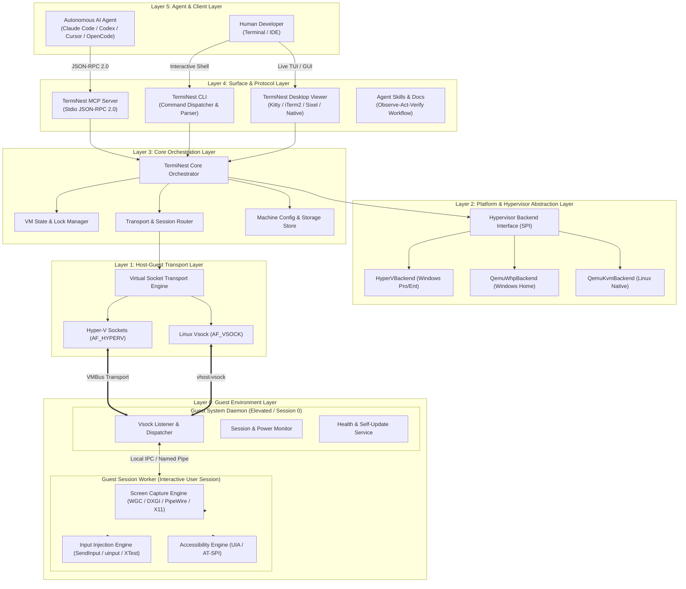
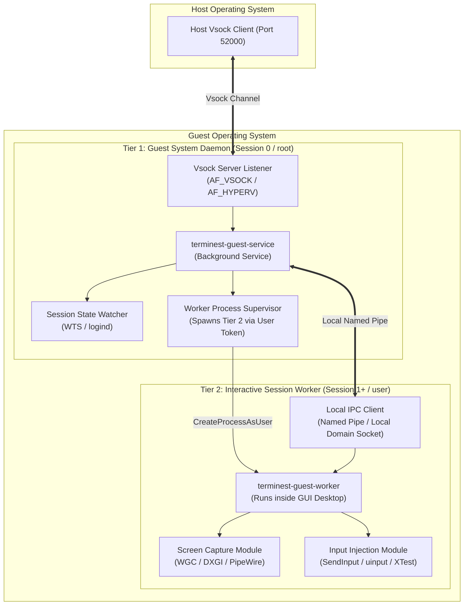

# Report 06: Target Systems Architecture & Component Design

**Document Status:** Complete & Audited  
**Author:** Principal Systems Architect & Cross-Platform Infrastructure Team  
**Date:** 2026-11-05  
**Subject:** Master system architecture for TermiNest cross-platform virtual computer infrastructure

---

## 1. High-Level Layered Architecture

TermiNest is designed as a **layered, modular architecture** that separates universal agent orchestration from native host hypervisors and guest operating-system APIs.



---

## 2. Platform Architecture: Statically Composed Adapters vs. Dynamic Plugins

We evaluated two architectural patterns for multi-platform support:

1. **Option A: Dynamic Plugin Architecture:** Loading external shared libraries (`.dll` / `.so`) or out-of-process gRPC plugins at runtime.
2. **Option B: Statically Composed Platform Adapters (Selected):** Compile-time interface satisfaction with static capability discovery.

### Evaluation & Rationale
Applying the **Codebase Design** (deep modules, minimal seams) and **Ponytail** (lean, zero-bloat) engineering principles:
- Dynamic plugins introduce runtime symbol resolution failures, cross-language ABI fragility, complex packaging overhead, and significant security exposure (dynamic DLL loading enables local privilege escalation and DLL hijacking).
- **Statically composed adapters** compile native code for the target host platform directly. A single clean trait/interface (`HypervisorBackend`) is implemented by `HyperVBackend`, `QemuWhpBackend`, and `QemuKvmBackend`.
- Capability discovery executes via deterministic feature probes (e.g. checking `/dev/kvm` presence or WMI Hyper-V class availability) and returns explicit capability bitmasks. Unsupported operations fail fast with typed errors rather than silent fallbacks.

---

## 3. Hypervisor Backend Interface (SPI)

The hypervisor contract defines an explicit lifecycle interface:

```rust
pub trait HypervisorBackend: Send + Sync {
    /// Detects hypervisor health, driver presence, and edition support.
    fn probe(&self) -> Result<HypervisorCapabilities, HypervisorError>;

    /// Generates hardware definitions and provisions virtual disks.
    fn create(&self, config: &MachineConfig, progress: ProgressCallback) -> Result<(), HypervisorError>;

    /// Starts the VM process in background daemon mode.
    fn start(&self, name: &str, options: StartOptions) -> Result<ProcessId, HypervisorError>;

    /// Queries live hypervisor state (stopped, starting, running, paused, error).
    fn status(&self, name: &str) -> Result<VmState, HypervisorError>;

    /// Requests clean guest ACPI shutdown.
    fn stop(&self, name: &str, timeout_secs: u32) -> Result<(), HypervisorError>;

    /// Immediately cuts virtual power (emergency/force stop).
    fn kill(&self, name: &str) -> Result<(), HypervisorError>;

    /// Pauses vCPU execution and freezes guest clock.
    fn pause(&self, name: &str) -> Result<(), HypervisorError>;

    /// Resumes vCPU execution.
    fn resume(&self, name: &str) -> Result<(), HypervisorError>;

    /// Creates a named CoW checkpoint of disk and state.
    fn snapshot_create(&self, name: &str, snapshot_name: &str) -> Result<(), HypervisorError>;

    /// Restores VM to a named checkpoint.
    fn snapshot_restore(&self, name: &str, snapshot_name: &str) -> Result<(), HypervisorError>;

    /// Deletes VM configuration, metadata, and virtual disks.
    fn destroy(&self, name: &str) -> Result<(), HypervisorError>;
}
```

### Capability Discovery Bitmask
```rust
bitflags! {
    pub struct HypervisorCapabilities: u32 {
        const HARDWARE_ACCELERATION = 1 << 0;
        const LIVE_SNAPSHOTS         = 1 << 1;
        const DISK_DIFFERENCING     = 1 << 2;
        const VSOCK_TRANSPORT       = 1 << 3;
        const GPU_ACCELERATION      = 1 << 4;
        const HEADLESS_DISPLAY      = 1 << 5;
        const PRIVATE_NETWORKING    = 1 << 6;
        const MEMORY_BALLOONING     = 1 << 7;
    }
}
```

---

## 4. Two-Tier Guest Helper Architecture

To overcome **Windows Session 0 Isolation** and **Linux Wayland Seat Isolation**, the guest helper operates across two distinct lifecycle processes:



### Tier 1: Guest System Daemon (`terminest-guest-service`)
- **Lifecycle:** Runs as an elevated background service (Windows Service in Session 0; systemd system service on Linux). Starts automatically at system boot before user login.
- **Responsibilities:**
  - Binds and listens on Vsock port `52000` (`AF_HYPERV` on Windows, `AF_VSOCK` on Linux).
  - Listens for terminal shutdown/reboot requests.
  - Monitors session state changes via `WTSRegisterSessionNotification` (Windows) or `sd_login_monitor` (Linux).
  - Automatically launches the Session Worker (Tier 2) upon detecting an active graphical user logon using `CreateProcessAsUser` (with the user's interactive token from `WTSQueryUserToken`).
  - Implements watchdog auto-restart if the session worker terminates unexpectedly.
  - Handles automated in-place updates delivered by the host.

### Tier 2: Guest Session Worker (`terminest-guest-worker`)
- **Lifecycle:** Runs with standard user privileges directly inside the active interactive desktop session (`WinSta0\Default` on Windows, graphical X11/Wayland seat on Linux).
- **Responsibilities:**
  - Connects to Tier 1 via a local IPC channel (local named pipe `\\.\pipe\terminest-guest-ipc` on Windows; local Unix domain socket `/run/user/<uid>/terminest.sock` on Linux).
  - Captures desktop frames via Windows Graphics Capture (WGC) or PipeWire/XShm.
  - Encodes frames as lossless LZ4 or compressed JPEG.
  - Injects synthetic mouse events and Unicode keystrokes via `SendInput` or `/dev/uinput`.
  - Normalizes coordinate spaces so that `(0, 0)` is strictly the top-left pixel of the display.

---

## 5. Host-Guest Communication Protocol Specification (TermiNest Wire Protocol v1)

TermiNest replaces the polling-based virtio-fs file exchange of `terminal-mac` with a **binary framed multiplexed socket protocol** over Vsock.

### Protocol Framing
All packets begin with an immutable 16-byte header:

```text
 0                   1                   2                   3
 0 1 2 3 4 5 6 7 8 9 0 1 2 3 4 5 6 7 8 9 0 1 2 3 4 5 6 7 8 9 0 1
+-+-+-+-+-+-+-+-+-+-+-+-+-+-+-+-+-+-+-+-+-+-+-+-+-+-+-+-+-+-+-+-+
|       Magic: 'T' 'N' 'S' 'T' (0x544E5354)                     |
+-+-+-+-+-+-+-+-+-+-+-+-+-+-+-+-+-+-+-+-+-+-+-+-+-+-+-+-+-+-+-+-+
|  Version (1)  | Channel (0/1) |           Reserved            |
+-+-+-+-+-+-+-+-+-+-+-+-+-+-+-+-+-+-+-+-+-+-+-+-+-+-+-+-+-+-+-+-+
|                      Payload Length (u32)                     |
+-+-+-+-+-+-+-+-+-+-+-+-+-+-+-+-+-+-+-+-+-+-+-+-+-+-+-+-+-+-+-+-+
|                   Payload CRC32-C Checksum                    |
+-+-+-+-+-+-+-+-+-+-+-+-+-+-+-+-+-+-+-+-+-+-+-+-+-+-+-+-+-+-+-+-+
|                       Payload Bytes ...                       |
+-+-+-+-+-+-+-+-+-+-+-+-+-+-+-+-+-+-+-+-+-+-+-+-+-+-+-+-+-+-+-+-+
```

### Channel Multiplexing
- **Channel 0 (Control Channel):** Low-latency, synchronous JSON-RPC 2.0 command messages (`click`, `type`, `key`, `drag`, `scroll`, `status`). Request timeout default 5000ms.
- **Channel 1 (Data Channel):** High-throughput binary streaming channel for frame acquisition, screenshot transfers, and binary asset streaming. Operates asynchronously without blocking Channel 0.

### Message Serialization
Payloads on Channel 0 use structured, schema-validated JSON:
```json
{
  "jsonrpc": "2.0",
  "id": "e4b2d312-32a4-4a25-b021-419b48b9a112",
  "method": "computer.click",
  "params": {
    "x": 640,
    "y": 400,
    "button": "left",
    "clicks": 1,
    "deadline_ms": 3000
  }
}
```

---

## 6. Common Computer-Use API Specification

The computer-use interface provides unified semantics across all platforms:

| Method Name | Input Parameters | Output Response | Semantic Guarantee |
|---|---|---|---|
| `computer.screenshot` | `format: "jpeg"|"png"|"raw"`, `quality: 1..100`, `max_width: u32`, `max_height: u32` | `width: u32`, `height: u32`, `format: string`, `data_base64: string` | Returns current visual state of the primary guest display in unified coordinate space. |
| `computer.click` | `x: u32`, `y: u32`, `button: "left"|"right"|"middle"`, `clicks: 1..3`, `screenshot: bool` | `success: bool`, `execution_ms: f64`, `screenshot?: ImageContent` | Dispatches pointer displacement followed by mousedown/mouseup sequence. |
| `computer.move` | `x: u32`, `y: u32`, `screenshot: bool` | `success: bool`, `screenshot?: ImageContent` | Displaces virtual cursor to reveal tooltips or hover states. |
| `computer.drag` | `from_x: u32`, `from_y: u32`, `to_x: u32`, `to_y: u32`, `steps: u32`, `screenshot: bool` | `success: bool`, `screenshot?: ImageContent` | Smooth drag interpolation; maintains button depression across trajectory. |
| `computer.scroll` | `x: u32`, `y: u32`, `dx: i32`, `dy: i32`, `screenshot: bool` | `success: bool`, `screenshot?: ImageContent` | Emits calibrated wheel ticks (negative `dy` scrolls content down). |
| `computer.type` | `text: string`, `screenshot: bool` | `characters_sent: u32`, `screenshot?: ImageContent` | Injects Unicode character stream directly. Bypasses host and guest clipboards. |
| `computer.key` | `key: string` (e.g. `ctrl+c`, `alt+tab`, `enter`, `super`), `screenshot: bool` | `success: bool`, `screenshot?: ImageContent` | Maps chord tokens to physical scan codes with exact modifier sequencing. |
| `computer.status` | None | `vm_state: string`, `session_state: string`, `display_width: u32`, `display_height: u32`, `helper_version: string` | Full operational health report of hypervisor, transport, and guest worker. |

---

## 7. Model Context Protocol (MCP) Server Architecture

The TermiNest MCP server operates as an autonomous protocol bridge:
- **Zero Hypervisor Coupling:** The MCP server communicates strictly with the local Host Orchestrator via IPC/socket. It contains zero platform-specific hypervisor or Win32/X11 code.
- **Client Agnostic:** Fully compatible with Claude Code, OpenAI Codex, Cursor, VS Code, and OpenCode.
- **Combined Inspect/Act Cycles:** When an agent specifies `screenshot: true` on an action tool, the MCP server pauses briefly (300–400ms) to allow UI repaints, requests a fresh screenshot from the Data Channel, and bundles both text confirmation and image blocks into a single JSON-RPC response. This cuts agent latency and token overhead by half.
- **Graceful Error Diagnosis:** If a guest session is locked or suspended, the MCP server reports a structured, actionable error:
  `"The guest operating system has no active interactive session (currently locked or at logon screen). Ask the user to sign in via 'terminest view <vm>'."`

---

## 8. Terminal Desktop Viewer Architecture

The `terminest view` subsystem renders live guest desktops directly inside supported developer terminals:
1. **Terminal Detection & Protocol Negotiation:**
   - Probes for Kitty graphics protocol support via `\u{1b}_Gi=31,s=1,v=1,a=q,t=s,f=32,S=4;<name>\u{1b}\\`.
   - Supports Kitty Shared Memory (`f=32, t=s`), Kitty Direct PNG (`a=T, f=100`), iTerm2 Inline Images, and Sixel graphics.
2. **Double-Buffered Rendering:**
   - Alternates between off-screen image IDs to eliminate flicker during screen updates.
3. **Decoupled Architecture:**
   - The viewer runs as an independent client process connecting to the Host Orchestrator. Exiting the viewer (`Ctrl+]`) leaves the Virtual Machine running undisturbed.
4. **Native Window Fallback:**
   - If the developer's terminal lacks graphics protocol support (e.g. legacy Windows console), `terminest view` opens an OS-native desktop window (rendered via lightweight SDL2 or native platform window).

---

*End of Report 06. Proceed to Technology Evaluation and Architecture Decision Records.*
