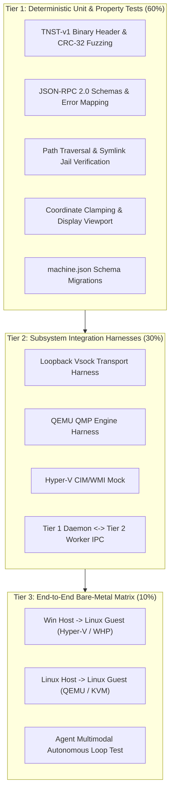
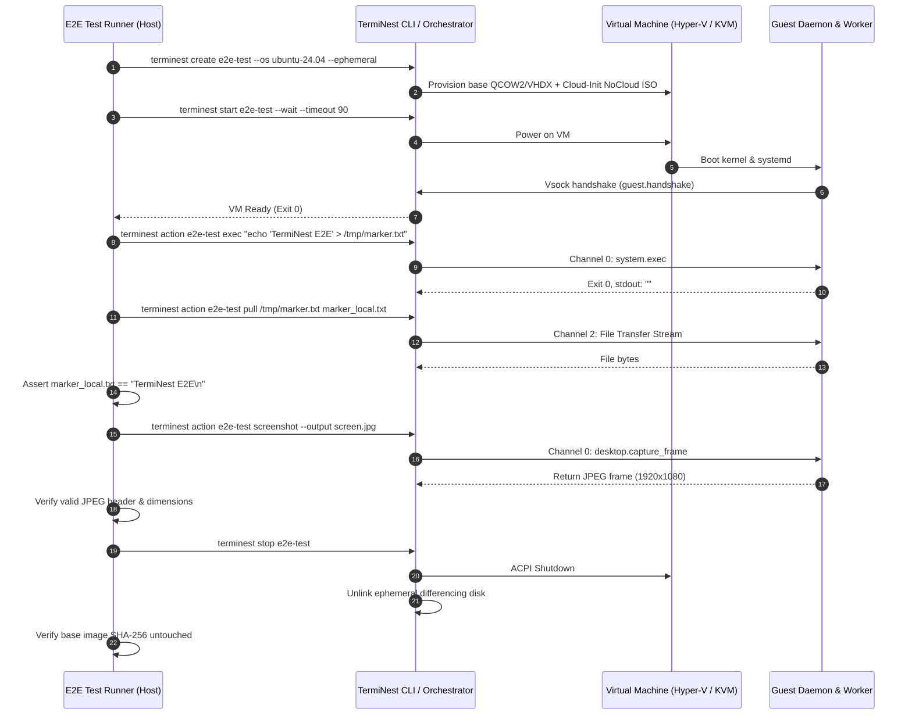
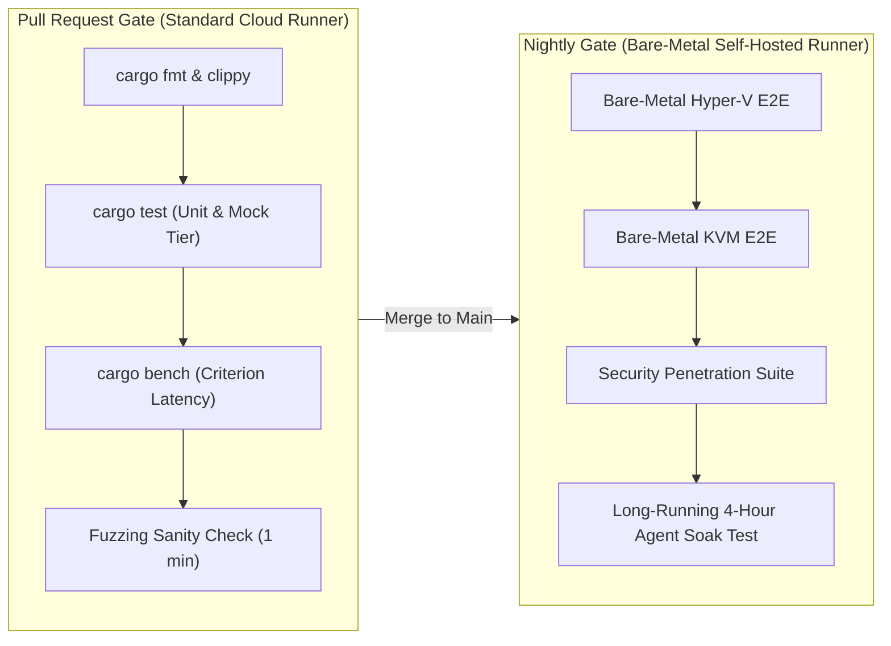

# Architecture Report 09: Testing, Verification, & Quality Strategy

**Status:** Approved Architectural Specification  
**Version:** 1.0.0  
**Date:** November 2026  
**System:** TermiNest Cross-Platform Virtual Computer Infrastructure  
**Author:** Staff Systems Engineer & QA/Reliability Architect  

---

## 1. Executive Summary & Quality Charter

TermiNest interfaces with bare-metal CPU virtualization extensions, OS kernel drivers, display pipelines, and autonomous AI agents. A defect in this system could corrupt virtual disk images, freeze developer workstations, or leak credentials across isolation boundaries.

The TermiNest Testing & Verification Strategy adheres to three core mandates:
1. **Deterministic Testability Without Bare-Metal Virtualization:** 90% of the codebase—including protocol multiplexing, JSON-RPC handling, coordinate clamping, state machines, and file streaming—must be testable in standard unprivileged GitHub Actions / GitLab CI environments without requiring hardware VT-x / AMD-V.
2. **Strict Seam Isolation:** Every major subsystem (Hypervisor, Transport, Display Capture, Input Injection) is isolated behind clean Rust traits, allowing automated substitution with high-fidelity mock harnesses.
3. **Automated Fuzzing & Security Hardening Verification:** The binary protocol framing, Vsock decoders, path resolvers, and network firewalls are continuously verified against adversarial test cases.

---

## 2. Test Pyramid & Architectural Seams



---

## 3. Tier 1: Unit & Property-Based Testing

Unit tests run in milliseconds and validate core algorithmic logic without starting virtual machines or touching OS hypervisor drivers.

### 3.1. Architectural Test Seams

#### 1. `MockHypervisorBackend`
The `HypervisorBackend` trait is decoupled from concrete platform hypervisors. The test harness implements an in-memory mock:

```rust
#[cfg(test)]
pub struct MockHypervisorBackend {
    pub state: std::sync::Arc<tokio::sync::Mutex<MachineState>>,
    pub launched_vms: std::sync::Arc<tokio::sync::Mutex<Vec<String>>>,
}

#[async_trait]
impl HypervisorBackend for MockHypervisorBackend {
    async fn create_vm(&self, config: &MachineConfig) -> Result<(), HypervisorError> {
        self.launched_vms.lock().await.push(config.name.clone());
        Ok(())
    }
    // ... complete state transition assertions
}
```

This allows full unit testing of `terminest start`, `terminest stop`, and state machine lifecycle transitions without launching real processes.

#### 2. In-Memory Vsock Duplex Channel
Using `tokio::io::duplex`, the protocol multiplexer and decoder are tested with zero network or hypervisor sockets:
- Validates 16-byte header parsing (`Magic`, `Version`, `Flags`, `Channel ID`, `Length`, `CRC-32C`).
- Tests packet reassembly when packets arrive fragmented across multiple arbitrary byte chunks (1-byte chunks, 3-byte chunks).
- Validates backpressure when Channel 1 (Display) is saturated, asserting Channel 0 (Control) commands are prioritized.

### 3.2. Property-Based Fuzzing & Security Tests

Using `proptest` and `cargo-fuzz`, the test suite verifies security boundaries:

| Test Harness | Target Module | Invariant Verified |
|---|---|---|
| `fuzz_wire_header` | `terminest-protocol::codec` | Any corrupted 16-byte header must result in an immediate `ProtocolError::InvalidHeader` without panic or out-of-bounds memory read. |
| `fuzz_path_jail` | `terminest-core::fs::sandbox` | Given an arbitrary attacker path string (including `..`, `\`, `/`, null bytes, symlinks), the resolved path must strictly satisfy `resolved.starts_with(allowed_root)` or return `PermissionDenied`. |
| `test_coord_clamping` | `terminest-core::action` | For any `(x, y)` coordinate where `x < 0`, `x >= width`, `y < 0`, or `y >= height`, the action must be rejected with `OutOfBounds` before dispatch. |
| `test_crc32_corruption` | `terminest-protocol::crc` | Modifying a single bit in a 1 MB payload must cause CRC verification failure. |

---

## 4. Tier 2: Subsystem Integration Testing

Integration tests verify interactions between components using lightweight mock servers or loopback sockets.

### 4.1. Vsock Loopback Transport Test Harness
A standalone binary harness executes both the Host Orchestrator transport layer and the Guest Helper Tier 1 daemon connected over a local loopback TCP or UNIX domain socket (simulating Vsock).
- Verifies the `guest.handshake` negotiation sequence.
- Tests heartbeat timeouts: asserts that when the guest drops connection, the host marks the machine state as `unresponsive` within 3 heartbeats (6 seconds).
- Verifies file transfer streaming over Channel 2: transmits a 50 MB randomized binary file, validates SHA-256 hash match on arrival, and verifies file descriptor cleanup.

### 4.2. Guest Inter-Tier IPC Verification
Inside the guest agent crate:
- Starts `terminest-guest-service` in a test process.
- Starts `terminest-guest-worker` in a child process.
- Tests session notification events: simulates user login, desktop lock, and user logout, verifying that the worker is gracefully signaled to terminate and respawn.

---

## 5. Tier 3: End-to-End (E2E) Bare-Metal Validation

End-to-End tests execute on dedicated bare-metal runners equipped with hardware virtualization (Windows Server / Desktop with Hyper-V; Ubuntu Linux with `/dev/kvm`).

### 5.1. Automated Headless E2E Test Workflow

Every nightly build executes the full automated validation cycle:



### 5.2. Platform Compatibility Test Matrix

| Test Suite ID | Host OS | Hypervisor | Guest OS | Critical Verification Focus |
|---|---|---|---|---|
| **E2E-WIN-LNX** | Windows 11 Pro | Hyper-V WMI | Ubuntu 24.04 | Vsock (`AF_HYPERV`), Cloud-init seed, headless Xvfb capture |
| **E2E-WIN-WIN** | Windows 11 Pro | Hyper-V WMI | Windows 11 Pro | Session 0 vs Session 1 worker launch, DXGI capture, SendInput |
| **E2E-LNX-LNX** | Ubuntu 24.04 | QEMU / KVM | Ubuntu 24.04 | QMP socket control, `/dev/vhost-vsock`, PipeWire capture |
| **E2E-LNX-WIN** | Ubuntu 24.04 | QEMU / KVM | Windows 11 Pro | QEMU Windows guest tools, virtio-win drivers, WGC capture |
| **E2E-WHP-LNX** | Windows 11 Home | QEMU / WHP | Ubuntu 24.04 | WHP acceleration stability, userspace Vsock emulation |

---

## 6. Performance Benchmarks & Latency Budgets

TermiNest defines hard performance budgets enforced via automated regression benchmarks (`cargo bench` using `criterion`):

| Metric | Target Budget | Upper Bound (Failure) | Measurement Method |
|---|---|---|---|
| **CLI Startup Latency** (`terminest --version`) | **< 8 ms** | > 20 ms | `hyperfine` over 50 runs |
| **Config Load & Parse** (`machine.json`) | **< 1 ms** | > 5 ms | Criterion benchmark |
| **Vsock RPC Round-Trip** (`guest.ping`) | **< 0.2 ms** | > 1.0 ms | 1,000 sequential pings over Vsock |
| **Display Capture Latency** (1080p DXGI / XShm) | **< 4 ms** | > 12 ms | Timestamp delta from capture call to buffer in RAM |
| **JPEG SIMD Compression** (1080p frame) | **< 5 ms** | > 15 ms | `turbojpeg` encode benchmark |
| **End-to-End Screenshot MCP Tool** | **< 15 ms** | > 40 ms | Client MCP request to base64 response |
| **Memory Footprint (Idle)** | **< 15 MB** RSS | > 30 MB RSS | Working set monitor on Host Orchestrator |
| **Memory Footprint (30 FPS Viewer Streaming)** | **< 35 MB** RSS | > 70 MB RSS | Working set monitor during live Kitty shm stream |

---

## 7. Security Verification & Hardening Tests

Automated security integration tests run against every release candidate:

### 1. Symlink Traversal Attack Test (`SEC-TEST-01`)
- Attacker script inside guest creates a symlink pointing to `/etc/shadow` or `C:\Windows\System32\config\SAM`.
- Agent invokes `pull_file` on the symlink.
- **Assertion:** Host orchestrator verifies realpath resolves within permitted sandbox; operation is aborted with `PermissionDenied`.

### 2. Network Isolation Verification (`SEC-TEST-02`)
- VM created with `networking: "isolated"`.
- Guest script attempts UDP DNS query to `8.8.8.8:53` and TCP connection to `1.1.1.1:80`.
- **Assertion:** Socket fails immediately with `ENETUNREACH` or times out; zero packets captured on host network interfaces.

### 3. Cloud Metadata Block Verification (`SEC-TEST-03`)
- VM created with `networking: "nat"`.
- Guest script executes HTTP GET to `http://169.254.169.254/latest/meta-data/`.
- **Assertion:** Host NAT firewall drops packet; HTTP request times out with zero bytes received.

### 4. Malformed Vsock Fuzzing (`SEC-TEST-04`)
- Host test engine blasts 50,000 randomized packets with corrupt lengths, wrong magic headers, and invalid CRC checksums at the guest daemon listener.
- **Assertion:** Daemon process memory remains flat, zero segfaults or panics occur, and valid subsequent packets are processed normally.

---

## 8. Continuous Integration & Release Gates



A release binary is only generated when both the Pull Request Gate and the Nightly Bare-Metal Gate achieve 100% pass rates across all targeted platforms.
