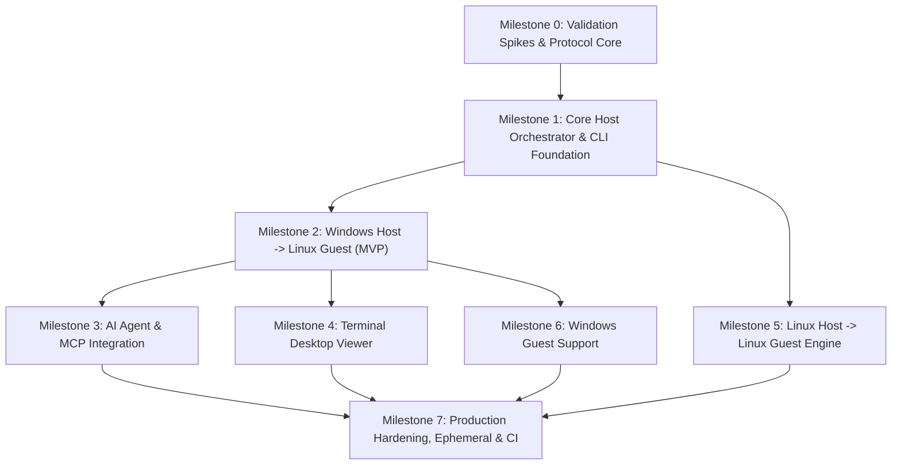

# Architecture Report 10: Implementation Roadmap & Execution Strategy

**Status:** Approved Architectural Specification  
**Version:** 1.0.0  
**Date:** November 2026  
**System:** TermiNest Cross-Platform Virtual Computer Infrastructure  
**Author:** Principal Systems Architect & Engineering Lead  

---

## 1. Roadmap Principles & Methodology

Systems engineering across hypervisors, kernel drivers, display servers, and AI protocols requires a strict, dependency-ordered engineering sequence. Attempting to implement UI viewers or agent skills before stabilizing the underlying transport guarantees rework.

### Guiding Principles:
1. **Dependency-Aware Ordering:** Foundations (protocol, transport, hypervisor backend) precede interfaces (CLI, MCP, Viewer, Skills).
2. **Relative Effort & Confidence:** Deliverables are sized in relative Engineering Effort Units (Story Points / Weeks of Focus) and assigned an explicit Confidence Level (High, Medium, Low) based on technical risk. Zero speculative calendar dates are used.
3. **Continuous Working State:** Every milestone produces an independently testable, functional artifact with verified automated test suites.
4. **MVP First:** The Minimum Viable Product focuses on the highest-utility combination: **Windows Host with Linux Guest**, followed rapidly by **Linux Host with Linux Guest**.

---

## 2. Milestone Dependency Graph

---

## 3. Detailed Milestone Breakdown

### Milestone 0: Feasibility Spikes & Protocol Core
**Primary Goal:** Prove kernel socket contracts, validate WMI/QMP access patterns, and establish shared serialization crates.

- **Deliverables:**
  1. `terminest-protocol` crate: Fixed 16-byte header codec, Castagnoli CRC-32C validation, JSON-RPC 2.0 framing, and unit tests with property fuzzing.
  2. Windows Vsock spike: Rust program verifying `AF_HYPERV` point-to-point socket communication against a test Hyper-V VM.
  3. Linux Vsock spike: Rust program verifying `AF_VSOCK` communication over `/dev/vhost-vsock`.
  4. Hyper-V WMI spike: Rust binary querying `Msvm_ComputerSystem` via WMI v2 without UAC elevation (using `Hyper-V Administrators` group).
  5. Linux QMP spike: Rust binary launching QEMU and issuing JSON-RPC commands over a UNIX domain socket.
- **Exit Criteria:** Protocol crate passes 50,000 fuzz cycles; bidirectional Vsock ping latency verified under 0.5ms on both platforms.
- **Effort Score:** Small (2 Weeks) | **Confidence:** High (95%)

---

### Milestone 1: Core Host Orchestrator & CLI Foundation
**Primary Goal:** Build the host application skeleton, CLI parser, configuration persistence, and mock test harness.

- **Deliverables:**
  1. Root workspace and CLI scaffolding (`clap` v4 with subcommands: `doctor`, `create`, `ls`, `start`, `status`, `stop`, `destroy`).
  2. Machine configuration manager: JSON schema validation, automatic directory layout creation (`%LOCALAPPDATA%\TermiNest` and `~/.local/share/terminest`).
  3. `HypervisorBackend` trait (SPI) and `MockHypervisorBackend` implementation.
  4. `terminest doctor` implementation: Checks CPU virtualization flags (VT-x/AMD-V), hypervisor status, user group memberships, and terminal capabilities.
- **Exit Criteria:** `cargo test` executes entire CLI lifecycle against `MockHypervisorBackend` in under 1 second in unprivileged CI.
- **Effort Score:** Medium (3 Weeks) | **Confidence:** High (90%)

---

### Milestone 2: Windows Host -> Linux Guest (MVP Candidate)
**Primary Goal:** Deliver the end-to-end Minimum Viable Product for developers running Windows Pro/Enterprise with Linux guests.

- **Deliverables:**
  1. `HyperVBackend` implementation: Programmatic VM creation, vCPU/RAM allocation, virtual switch binding, VHDX attachment.
  2. Unattended Linux Provisioning: Cloud-init NoCloud seed ISO generation (injecting user credentials, Vsock service, and display packages).
  3. Linux Guest Agent (Tier 1 Daemon): Systemd service binding `AF_VSOCK` port 10001, executing system commands.
  4. Linux Guest Worker (Tier 2): Xvfb / X11 worker capturing display via XShm, encoding JPEG, and injecting inputs via XTest.
  5. CLI Computer-Use commands: `terminest action <vm> screenshot`, `click`, `type`, `key`, `exec`.
- **Exit Criteria:** A developer can run `terminest create test --os ubuntu-24.04`, `terminest start test`, and take an automated screenshot via CLI in under 60 seconds from cold boot.
- **Effort Score:** Large (5 Weeks) | **Confidence:** High (85%)

---

### Milestone 3: AI Agent & MCP Integration
**Primary Goal:** Enable autonomous agents (Claude Code, OpenAI Codex, OpenCode) to control virtual computers via standardized MCP stdio interfaces.

- **Deliverables:**
  1. In-process MCP Server: Implemented directly in Rust inside the `terminest` binary, communicating over `stdio` JSON-RPC 2.0.
  2. Complete MCP Computer-Use tool surface: `computer_screenshot`, `computer_mouse_click`, `computer_mouse_move`, `computer_mouse_drag`, `computer_key_sequence`, `computer_type_text`, `computer_exec`, `computer_push_file`, `computer_pull_file`.
  3. Defensive guardrails: Viewport coordinate clamping, destructive command blocking, and sanitized error responses.
  4. Agent Prompt Pack & Skill (`terminest` skill): Packaged skill providing the observe-act-verify loop for autonomous agents.
- **Exit Criteria:** Claude Code successfully executes an autonomous multi-step desktop task (e.g., opens a browser, searches for a query, saves a text file) inside the guest VM via `terminest mcp`.
- **Effort Score:** Medium (3 Weeks) | **Confidence:** High (90%)

---

### Milestone 4: Terminal Desktop Viewer
**Primary Goal:** Provide real-time, low-latency visual supervision for developers directly within the terminal emulator.

- **Deliverables:**
  1. Protocol Channel 1 streaming: Guest worker continuously captures and streams compressed JPEG/LZ4 frames at 10-30 FPS over Vsock.
  2. Terminal Graphics Engine:
     - Kitty Graphics Protocol with POSIX/Windows shared memory (`t=s`, `t=f`) for Ghostty and Kitty.
     - Chunked base64 streaming fallback for WezTerm and Mintty.
  3. Native Window Fallback: Ultra-lightweight native mini-window (`terminest view --window`) using `winit` and `softbuffer` (~5 MB RSS).
- **Exit Criteria:** `terminest view <vm>` renders smooth 30 FPS desktop video in Ghostty/Kitty with under 50ms glass-to-glass latency and zero noticeable impact on agent execution.
- **Effort Score:** Medium (3 Weeks) | **Confidence:** Medium (80%)

---

### Milestone 5: Linux Host -> Linux Guest Engine
**Primary Goal:** Expand TermiNest to Linux workstations and CI servers using direct QEMU/KVM virtualization.

- **Deliverables:**
  1. `QemuKvmBackend` implementation: Spawns and manages `qemu-system-x86_64` processes via QMP over local UNIX domain sockets.
  2. Kernel `/dev/vhost-vsock` integration for Host Orchestrator.
  3. Wayland display capture support in Linux guest worker (PipeWire Screencast via portal and `libei` emulated input).
  4. Linux packaging: Debian/Ubuntu `.deb`, Arch PKGBUILD, and standalone static binaries (`musl`).
- **Exit Criteria:** Full feature parity with Milestone 2 running natively on Ubuntu 24.04 LTS host.
- **Effort Score:** Large (4 Weeks) | **Confidence:** High (85%)

---

### Milestone 6: Windows Guest Support
**Primary Goal:** Allow AI agents to operate Windows 11 desktop environments on both Windows and Linux hosts.

- **Deliverables:**
  1. Windows Guest Provisioning: Automated `autounattend.xml` generator injecting answer files into Windows installation media.
  2. Windows Tier 1 System Daemon (`terminest-guest-service.exe`): Windows Service in Session 0 managing Vsock listener and user session monitoring via `WTSRegisterSessionNotification`.
  3. Windows Tier 2 Session Worker (`terminest-guest-worker.exe`): Spawned via `CreateProcessAsUserW` in active Session 1; screen capture via DXGI Desktop Duplication API; input injection via Win32 `SendInput`.
  4. Integration with Hyper-V (Windows host) and QEMU + `virtio-win` drivers (Linux host).
- **Exit Criteria:** Agent autonomously launches Windows Notepad, types text, and saves a file on a Windows 11 guest virtual desktop.
- **Effort Score:** Extra-Large (6 Weeks) | **Confidence:** Medium (75%)

---

### Milestone 7: Production Hardening, Ephemeral State & CI Matrix
**Primary Goal:** Enterprise-grade security confinement, disposable state management, and automated continuous delivery.

- **Deliverables:**
  1. Ephemeral Execution Mode: Copy-on-Write differencing disks (child VHDX on Windows, backing-file QCOW2 on Linux) with automatic teardown and deletion on stop.
  2. Network Isolation Tiers: Automated configuration of `isolated` internal switches and `nat` host-only subnets with RFC 1918 and cloud metadata (`169.254.169.254`) packet filtering.
  3. Bare-Metal Continuous Integration (CI) pipeline: Automated nightly regression tests executing on Windows and Linux runners with VT-x/AMD-V enabled.
  4. Public documentation, CLI manpages, and security audit sign-off.
- **Exit Criteria:** 100 consecutive automated ephemeral test runs execute with zero disk leaks, zero packet leakage to host LAN, and zero test flakiness.
- **Effort Score:** Large (4 Weeks) | **Confidence:** High (90%)

---

## 4. Resource Allocation & Critical Path Summary

| Milestone | Deliverables | Relative Effort | Risk Profile | Primary Prerequisite |
|---|---|---|---|---|
| **M0** | Protocol & Spikes | 2 Weeks | Low Risk | None |
| **M1** | Core & CLI Scaffolding | 3 Weeks | Low Risk | M0 |
| **M2** | Win -> Linux MVP | 5 Weeks | Medium Risk | M1 |
| **M3** | MCP Server & Agent Skill | 3 Weeks | Low Risk | M2 |
| **M4** | Terminal Desktop Viewer | 3 Weeks | Medium Risk | M2 |
| **M5** | Linux -> Linux Engine | 4 Weeks | Medium Risk | M1 |
| **M6** | Windows Guest Support | 6 Weeks | High Risk | M2 |
| **M7** | Hardening, CoW & CI | 4 Weeks | Medium Risk | M3, M4, M5, M6 |

**The Critical Path to MVP:** `M0 -> M1 -> M2 -> M3` (Total: ~13 Weeks of concentrated systems engineering).
At the conclusion of Milestone 3, TermiNest is fully functional as a production-grade headless computer-use infrastructure for AI agents on Windows hosts.
